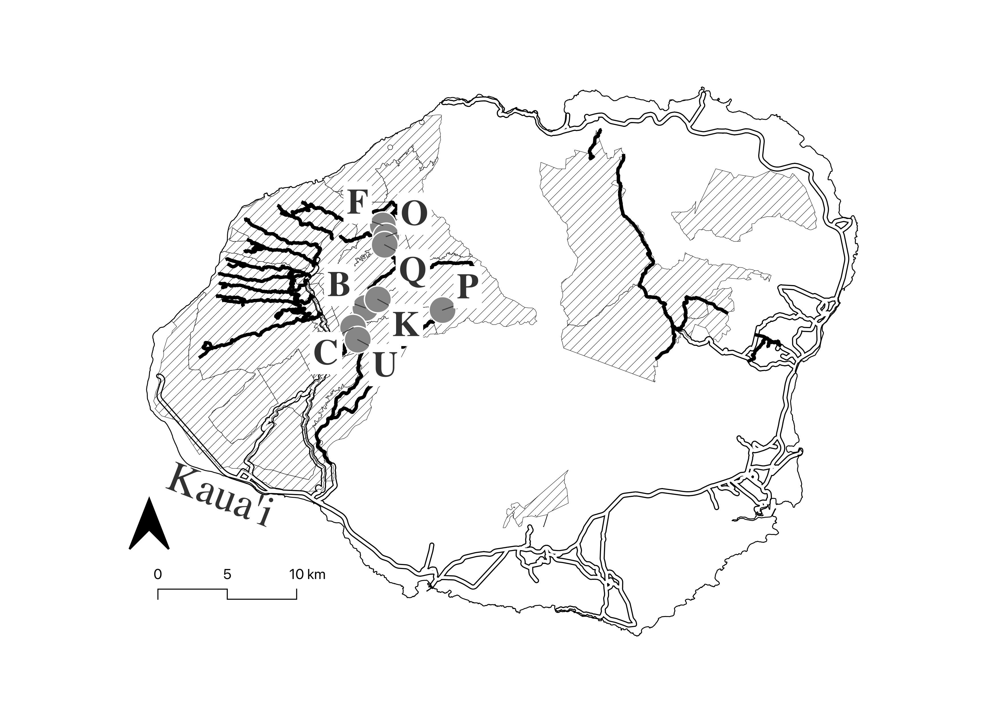
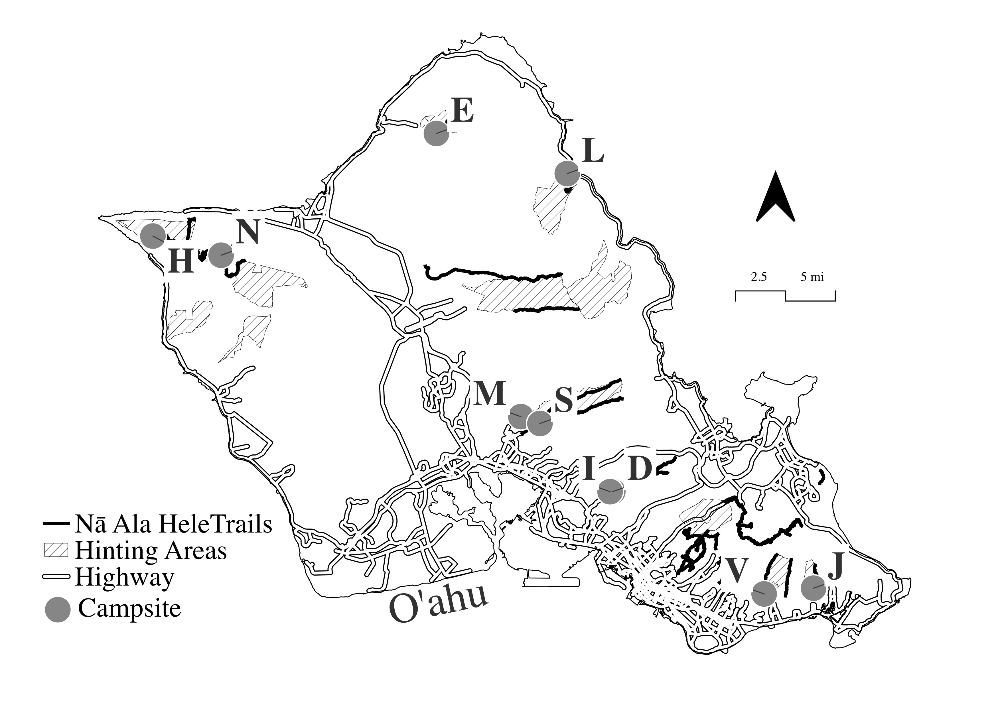
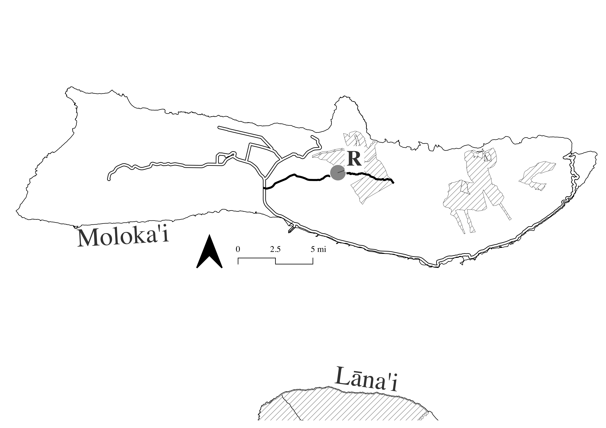
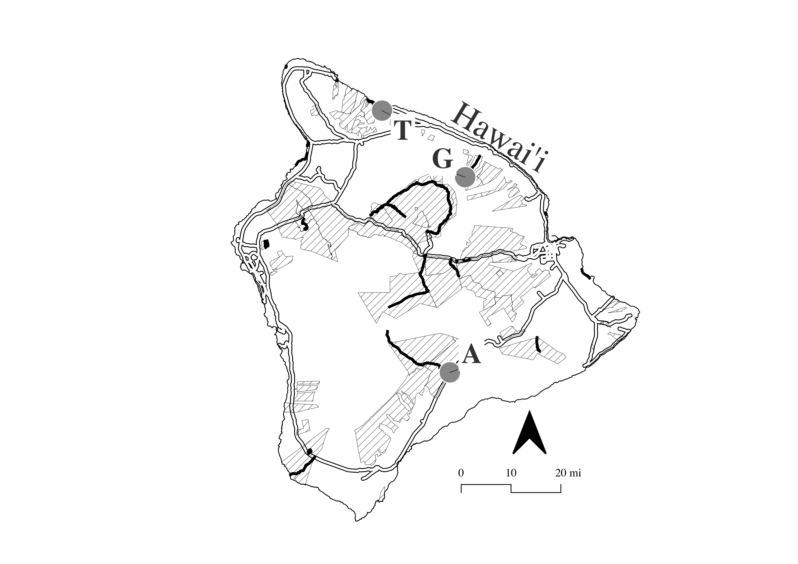

This site provides a walk through on the results from "Repeated Random Utility versus Kuhn-Tucker Models over Time: Evidence from Hawaiʻi Campsites". This tab covers the comparison by loading the data from the models. Tabs MDCEV and RUM are the codes that will run each model.

# Libraries

```{r, message=FALSE}


library(dplyr)
library(tidyr)
library(haven)
library(readr)
library(mlogit)
library(lmtest)
library(purrr)
library(stringr)
library(readr)
library(ggplot2)
library(stargazer)
library(readxl)
library(patchwork)
library(broom)
library(tidyverse)
library(sf)
library(tigris)
library(ggrepel)
library(ggspatial)
library(ggpattern)


```

# Load Data/Models

This code loads the dataframe need to recreate all tables from the paper.

```{r}

final_comparison_master=read_csv("data/final_comparison_master.csv")

# Raw
final_data_2018 <- readRDS("data/final_data_2018.rds")
final_data_2019 <- readRDS("data/final_data_2019.rds")
final_data_2020 <- readRDS("data/final_data_2020.rds")
final_data_2021 <- readRDS("data/final_data_2021.rds")
final_data_2022 <- readRDS("data/final_data_2022.rds")
final_data_2023 <- readRDS("data/final_data_2023.rds")

# RUM
model_list_52 <- readRDS("data/rum/model_list_52.rds")
kr_list_52 <- readRDS("data/rum/kr_list_52.rds")
welfare_rum_list <- readRDS("data/rum/welfare_rum_list.rds")


# MDVEC 
mdcev_model_list <- readRDS("data/mdcev/mdcev_model_list.rds")
welfare_list <- readRDS("data/mdcev/welfare_list_100.rds")
welfare_ind_list <- readRDS("data/mdcev/welfare_ind_list_100.rds")
welfare_x2_list <- readRDS("data/satiation/welfare_x2_list_100.rds")
welfare_x4_list <- readRDS("data/satiation/welfare_x4_list_100.rds")


# MDVEC 
mdcev_cf_2018_both_equal <- readRDS("data/tc_constant/mdcev_cf_v2_2018_both_equal.rds")
mdcev_cf_v2_2018_equal_distance <- readRDS("data/tc_constant/mdcev_cf_v2_2018_equal_distance.rds")
mdcev_cf_v2_2018_equal_vot<- readRDS("data/tc_constant/mdcev_cf_v2_2018_equal_vot.rds")

mdcev_cf_2019_both_equal <- readRDS("data/tc_constant/mdcev_cf_v2_2019_both_equal.rds")
mdcev_cf_v2_2019_equal_distance <- readRDS("data/tc_constant/mdcev_cf_v2_2019_equal_distance.rds")
mdcev_cf_v2_2019_equal_vot<- readRDS("data/tc_constant/mdcev_cf_v2_2019_equal_vot.rds")

mdcev_cf_2020_both_equal <- readRDS("data/tc_constant/mdcev_cf_v2_2020_both_equal.rds")
mdcev_cf_v2_2020_equal_distance <- readRDS("data/tc_constant/mdcev_cf_v2_2020_equal_distance.rds")
mdcev_cf_v2_2020_equal_vot<- readRDS("data/tc_constant/mdcev_cf_v2_2020_equal_vot.rds")

mdcev_cf_2021_both_equal <- readRDS("data/tc_constant/mdcev_cf_v2_2021_both_equal.rds")
mdcev_cf_v2_2021_equal_distance <- readRDS("data/tc_constant/mdcev_cf_v2_2021_equal_distance.rds")
mdcev_cf_v2_2021_equal_vot<- readRDS("data/tc_constant/mdcev_cf_v2_2021_equal_vot.rds")

mdcev_cf_2022_both_equal <- readRDS("data/tc_constant/mdcev_cf_v2_2022_both_equal.rds")
mdcev_cf_v2_2022_equal_distance <- readRDS("data/tc_constant/mdcev_cf_v2_2022_equal_distance.rds")
mdcev_cf_v2_2022_equal_vot<- readRDS("data/tc_constant/mdcev_cf_v2_2022_equal_vot.rds")


mdcev_cf_2023_both_equal <- readRDS("data/tc_constant/mdcev_cf_v2_2023_both_equal.rds")
mdcev_cf_v2_2023_equal_distance <- readRDS("data/tc_constant/mdcev_cf_v2_2023_equal_distance.rds")
mdcev_cf_v2_2023_equal_vot<- readRDS("data/tc_constant/mdcev_cf_v2_2023_equal_vot.rds")

```

# Coefficient Tables

## HawaiianName

```{r}

SITE_NAMES <- c(
  ainapo      = "\u02BB\u0100inap\u014D",   # ʻĀinapō
  hipalau     = "Hipalau",
  kaluahaulu  = "Kaluahaulu",
  kamananui   = "Kamananui",
  kaunala     = "Kaunala",
  kawaikoi    = "Kawaikoi",
  keanakolu   = "Keanakolu",
  kuaokala    = "Kuaokal\u0101",             # Kuaokalā
  kulanaahane = "Kulana\u02BBahane",         # Kulanaʻahane
  kuliouou    = "Kuli\u02BBou\u02BBou",      # Kuliʻouʻou
  lonomea     = "Lonomea",
  maakua      = "Ma\u02BBakua",              # Maʻakua
  manana      = "M\u0101nana",               # Mānana
  peacock     = "Peacock Flats",
  sugi        = "Sugi Grove",
  waialae     = "Wai\u02BBalae",             # Waiʻalae
  waikoali    = "Waikoali",
  waikolu     = "Waikolu",
  waimano     = "Waimano",
  waimanu     = "Waimanu",
  wiliwili    = "Wiliwili",
  wiliwilinui = "Wiliwilinui")

site_key <- function(x) {
  w <- sub(" .*", "", x)                                          # first word
  w <- iconv(w, "UTF-8", "ASCII//TRANSLIT")                       # drop macrons
  tolower(gsub("[^A-Za-z]", "", w))                               # drop ʻokina, punctuation
}
 
```

## Table 1 - MDCEV

### B.1

### B.2

Include Appendix table B.1 (2019-2020) and B.2 (2021-2022)

```{r}

## Estimates for one model 
## Estimate = MLE; s.e. = standard deviation of the 100 saved parameter draws (rmdcev's "mvn" method)
kt_data <- function(mod) {
  th  <- as.matrix(mod$stan_fit$theta_tilde)
  est <- function(p) as.numeric(unlist(mod$stan_fit$par[[p]]))
  se  <- function(p) as.numeric(apply(th[, grep(paste0("^", p, "\\["), colnames(th)), drop = FALSE], 2, sd))
  alts <- mod$parms_info$alt_names
  if (is.null(alts)) alts <- mod$parms_info$parm_names$alt_names
  J <- length(alts)
  b <- est("psi"); b_se <- se("psi"); g <- est("gamma"); g_se <- se("gamma")
  stopifnot(length(b) %in% c(J - 1, J), length(g) == J, length(g_se) == J)
  k <- length(b) + J + 2                                          # psi, gamma, alpha, scale
  if (length(b) == J - 1) { b <- c(0, b); b_se <- c(NA, b_se) }    # first site is the base (fixed)
  ll <- if (!is.null(mod$log.likelihood)) as.numeric(mod$log.likelihood) else as.numeric(mod$stan_fit$value)
  n  <- mod$stan_data$I
  list(sites = data.frame(key = site_key(alts), b = b, b_se = b_se, g = g, g_se = g_se),
       alpha = c(est("alpha")[1], se("alpha")[1]),
       scale = c(est("scale")[1], se("scale")[1]),
       ll = ll, aic = -2 * ll + 2 * k, bic = -2 * ll + k * log(n), obs = n * J, n = n)
}
 
stars <- function(e, s) {
  p <- 2 * pnorm(-abs(e / s))
  ifelse(is.na(p), "", ifelse(p < 0.01, "***", ifelse(p < 0.05, "**", ifelse(p < 0.1, "*", ""))))
}
f3   <- function(x) formatC(x, format = "f", digits = 3, big.mark = ",")
f0   <- function(x) formatC(round(x), format = "d", big.mark = ",")
 
##  Table as a data frame of text (rows = campsites + model rows, 4 columns per year) 
kt_text_table <- function(years) {
  E <- lapply(as.character(years), function(y) kt_data(mdcev_model_list[[y]]))
  keys <- unique(unlist(lapply(E, function(e) e$sites$key)))
  miss <- setdiff(keys, names(SITE_NAMES))
  if (length(miss)) message("no display name for: ", paste(miss, collapse = ", "))
  keys <- keys[order(match(keys, names(SITE_NAMES)), keys)]        # order of SITE_NAMES
 
  site_cols <- function(e, k) {
    r <- e$sites[e$sites$key == k, ]
    if (nrow(r) == 0) return(rep("\u2013", 4))                     # not available that year
    c(paste0(f3(r$b), if (is.na(r$b_se)) "" else stars(r$b, r$b_se)),
      if (is.na(r$b_se)) "fixed" else f3(r$b_se),
      paste0(f3(r$g), stars(r$g, r$g_se)),
      f3(r$g_se))
  }
  par_cols <- function(v) c(paste0(f3(v[1]), stars(v[1], v[2])), f3(v[2]), "-", "-")
 
  rows <- c(
    lapply(keys, function(k) c(ifelse(k %in% names(SITE_NAMES), SITE_NAMES[k], k),
                               unlist(lapply(E, site_cols, k = k)))),
    list(c("\u03B1", unlist(lapply(E, function(e) par_cols(e$alpha)))),
         c("\u03C3", unlist(lapply(E, function(e) par_cols(e$scale))))))
  tab <- as.data.frame(do.call(rbind, rows), stringsAsFactors = FALSE)
  names(tab) <- c("Campsite", paste0(rep(c("beta_", "beta_se_", "gamma_", "gamma_se_"), length(years)),
                                     rep(years, each = 4)))
  ## one value per model, spanning that model's four columns
  stats <- data.frame(
    label = c("Log-likelihood", "AIC", "BIC", "Observations", "Individuals"),
    sapply(E, function(e) c(f3(e$ll), f0(e$aic), f0(e$bic), f0(e$obs), f0(e$n))))
  list(tab = tab, stats = stats)
}
 
## HTML code needed to create table
td <- function(x, align = "center", span = 1)
  paste0('<td', if (span > 1) paste0(' colspan="', span, '"'), ' style="text-align:', align,
         '; padding:2px 8px;">', x, "</td>")
 
make_kt_table <- function(years, labels, title, file) {
  T <- kt_text_table(years)
  print(T$tab, row.names = FALSE); print(T$stats, row.names = FALSE)   # check the numbers here
 
  esc  <- function(x) gsub("&", "&amp;", x)
  body <- apply(T$tab, 1, function(r)
    paste0("<tr>", td(esc(r[1]), "left"), paste(sapply(r[-1], td), collapse = ""), "</tr>"))
  body[length(body) - 1] <- sub("<tr>", '<tr style="border-top:1px solid black;">', body[length(body) - 1])
  stats <- apply(T$stats, 1, function(r)
    paste0("<tr>", td(r[1], "left"), paste(sapply(r[-1], td, span = 4), collapse = ""), "</tr>"))
  stats[1] <- sub("<tr>", '<tr style="border-top:1px solid black;">', stats[1])
 
  head1 <- paste0('<tr style="border-top:2px solid black;"><td rowspan="2" style="padding:2px 8px;"></td>',
                  paste0('<td colspan="4" style="text-align:center; padding:2px 8px; border-bottom:1px solid black;">',
                         labels, " - ", years, "</td>", collapse = ""), "</tr>")
  head2 <- paste0('<tr style="border-bottom:1px solid black;">',
                  paste(rep(paste0(td("Mean &beta;<sub>q</sub>"), td("s.e."),
                                   td("Mean &gamma;<sub>j</sub>"), td("s.e.")), length(years)),
                        collapse = ""), "</tr>")
  notes <- paste0('<tr style="border-top:2px solid black;"><td colspan="', 1 + 4 * length(years),
                  '" style="padding:4px 8px; font-size:10pt;">',
                  "Notes: *p<0.1, **p<0.05, ***p<0.01. Standard errors (s.e.) are computed using simulation-based multivariate normal approximation (MVN) with 100 draws. Campsite constant (normalized to zero for ʻĀinapō) = β_q. Satiation at campsite = γ_j. Satiation in numeraire = α, Scale parameter = σ. – indicates that the campsite was not available in that year.", SITE_NAMES[["ainapo"]],
                  " is the reference campsite (&beta;<sub>q</sub> fixed at 0). &ndash; = campsite not available that year.",
                  "</td></tr>")
 
  html <- paste0('<html><head><meta charset="UTF-8"></head>',
                 '<body style="font-family:\'Times New Roman\', serif; font-size:11pt;">',
                 "<p><b>", title, "</b></p>",
                 '<table style="border-collapse:collapse;">',
                 head1, head2, paste(body, collapse = ""), paste(stats, collapse = ""), notes,
                 "</table></body></html>")
  con <- file(file, encoding = "UTF-8"); writeLines(enc2utf8(html), con); close(con)
  message("wrote ", file)
}
 
## Main Table and Appendix
make_kt_table(c(2018, 2023), c("Model 1", "Model 2"),
  "Table 1. Kuhn-Tucker models with multiple discrete-continuous extreme value specification.",
  "tables/table_1_mdcev_2018_2023.html")
 
make_kt_table(c(2019, 2020), c("Model 1", "Model 2"),
  "Table B.1. Kuhn-Tucker models with multiple discrete-continuous extreme value specification.",
  "tables/table_B1_mdcev_2019_2020.html")
 
make_kt_table(c(2021, 2022), c("Model 1", "Model 3"),
  "Table B.2. Kuhn-Tucker models with multiple discrete-continuous extreme value specification.",
  "tables/table_B2_mdcev_2021_2022.html")
 
```

## Table 2 - RUM

### B.3

Includes Table B.3 in appendix

```{r}
stars <- function(e, s) {
  p <- 2 * pnorm(-abs(e / s))
  ifelse(is.na(p), "", ifelse(p < 0.01, "***", ifelse(p < 0.05, "**", ifelse(p < 0.1, "*", ""))))
}
fnum <- function(x, d = 3) sub("^-", "\u2212", formatC(x, format = "f", digits = d, big.mark = ","))
f0   <- function(x) formatC(round(x), format = "d", big.mark = ",")
td   <- function(x, align = "center", span = 1, style = "")
  paste0('<td', if (span > 1) paste0(' colspan="', span, '"'), ' style="text-align:', align,
         '; padding:2px 8px;', style, '">', x, "</td>")

##Estimates for one model 
rum_data <- function(m) {
  b  <- coef(m); se <- sqrt(diag(vcov(m)))
  int <- grepl("^\\(Intercept\\):", names(b))
  oid <- tryCatch(idx(m, 1), error = function(e) idx(m$model, 1))
  occ <- length(unique(oid))
  list(sites = data.frame(key = site_key(sub("^\\(Intercept\\):", "", names(b)[int])),
                          b = b[int], se = se[int]),
       price = c(b[!int][1], se[!int][1]),
       ll = as.numeric(logLik(m)), obs = occ, n = occ / 52)
}
 
## Build one table 
make_rum_table <- function(years, title, file, price_digits = 4) {
  E <- lapply(years, function(y) rum_data(model_list_52[[paste("52wk", y)]]))
  keys <- unique(unlist(lapply(E, function(e) e$sites$key)))
  miss <- setdiff(keys, names(SITE_NAMES))
  if (length(miss)) message("no display name for: ", paste(miss, collapse = ", "))
  keys <- keys[order(match(keys, names(SITE_NAMES)), keys)]
 
  site_cells <- function(e, k) {
    r <- e$sites[e$sites$key == k, ]
    if (nrow(r) == 0) return(c("\u2013", "\u2013"))                  # not available that year
    c(paste0(fnum(r$b), stars(r$b, r$se)), fnum(r$se))
  }
  tab <- do.call(rbind, c(
    lapply(keys, function(k) c(ifelse(k %in% names(SITE_NAMES), SITE_NAMES[k], k),
                               unlist(lapply(E, site_cells, k = k)))),
    list(c("Travel cost", unlist(lapply(E, function(e)
      c(paste0(fnum(e$price[1], price_digits), stars(e$price[1], e$price[2])),
        fnum(e$price[2], price_digits))))))))
  stats <- rbind(c("Log-likelihood", sapply(E, function(e) fnum(e$ll))),
                 c("Observations",   sapply(E, function(e) f0(e$obs))),
                 c("Individuals",    sapply(E, function(e) f0(e$n))))
  print(tab); print(stats)                                            # check the numbers here
 
  body <- apply(tab, 1, function(r)
    paste0("<tr>", td(r[1], "left"), paste(sapply(r[-1], td), collapse = ""), "</tr>"))
  body[length(body)] <- sub("<tr>", '<tr style="border-top:1px solid black;">', body[length(body)])
  st <- apply(stats, 1, function(r)
    paste0("<tr>", td(r[1], "left"), paste(sapply(r[-1], td, span = 2), collapse = ""), "</tr>"))
  st[1] <- sub("<tr>", '<tr style="border-top:1px solid black;">', st[1])
 
  head1 <- paste0('<tr style="border-top:2px solid black;"><td style="padding:2px 8px;"></td>',
                  paste0('<td colspan="2" style="text-align:center; padding:2px 8px; border-bottom:1px solid black;">',
                         years, "</td>", collapse = ""), "</tr>")
  head2 <- paste0('<tr style="border-bottom:1px solid black;">', td("Campsite", "left"),
                  paste(rep(paste0(td("Coef."), td("s.e.")), length(years)), collapse = ""), "</tr>")
  notes <- paste0('<tr style="border-top:2px solid black;"><td colspan="', 1 + 2 * length(years),
                  '" style="padding:4px 8px; font-size:10pt;">',
                  "*p<0.1, **p<0.05, ***p<0.01. Repeated random utility model estimated as a conditional logit with 52 weekly choice occasions per camper. Staying home is the reference alternative, so the campsite coefficients are alternative-specific constants relative to staying home. – indicates that the campsite was not available in that year. ",
                  "&ndash; = campsite not available that year.</td></tr>")
 
  html <- paste0('<html><head><meta charset="UTF-8"></head>',
                 '<body style="font-family:\'Times New Roman\', serif; font-size:11pt;">',
                 "<p><b>", title, "</b></p>",
                 '<table style="border-collapse:collapse;">',
                 head1, head2, paste(body, collapse = ""), paste(st, collapse = ""), notes,
                 "</table></body></html>")
  con <- file(file, encoding = "UTF-8"); writeLines(enc2utf8(html), con); close(con)
  message("wrote ", file)
}
 
## Tables 
make_rum_table(c(2018, 2023), "Table 2. Repeated Random Utility models",
               "tables/table_2_rum_2018_2023.html")
make_rum_table(c(2019, 2020,2021, 2022), "Table B.3. Repeated Random Utility models",
               "tables/table_B3_rum_2019_2023.html")


 
```

## Table 3 -Welfare

### B.4

### B.5

Includes Table B.4-B.5 in appendix

```{r}


## MDCEV: per-draw mean loss per camper, each policy 
md_welfare <- function(y) {
  y <- as.character(y)
  w <- welfare_list[[y]]; mod <- mdcev_model_list[[y]]; J <- mod$stan_data$J
  alts <- mod$parms_info$alt_names
  if (is.null(alts)) alts <- mod$parms_info$parm_names$alt_names
  D <- Reduce(`+`, lapply(w, function(m) as.matrix(m)[, 1:(J + 1), drop = FALSE])) / length(w)
  data.frame(key = c(site_key(alts), "system"), est = colMeans(D),
             lo = apply(D, 2, quantile, 0.025), hi = apply(D, 2, quantile, 0.975))
}

## RUM: read the saved Krinsky-Robb summary 
## summary rows: one per campsite, "All sites closed", plus totals that are not shown here
rum_welfare <- function(y) {
  s <- welfare_rum_list[[as.character(y)]]$summary
  s <- s[!s$measure %in% c("Sum of single-site losses", "Average site closure"), ]
  data.frame(key = ifelse(s$measure == "All sites closed", "system", site_key(s$measure)),
             est = s$mean, lo = s$lower, hi = s$upper)
}

## Build one table 
make_welfare_table <- function(years, title, file) {
  W <- lapply(years, function(y) list(md = md_welfare(y), rum = rum_welfare(y)))
  keys <- setdiff(unique(unlist(lapply(W, function(w) c(w$md$key, w$rum$key)))), "system")
  miss <- setdiff(keys, names(SITE_NAMES))
  if (length(miss)) message("no display name for: ", paste(miss, collapse = ", "))
  keys <- c(keys[order(match(keys, names(SITE_NAMES)), keys)], "system")
td_w <- function(x, align = "center", style = "")
  paste0('<td style="text-align:', align, '; padding:1px 8px;', style, '">', x, "</td>")
  get <- function(d, k) d[d$key == k, ]
  est_cell <- function(d, k) { r <- get(d, k); if (nrow(r) == 0) "\u2013" else fnum(r$est) }
  ci_cell  <- function(d, k) { r <- get(d, k); if (nrow(r) == 0) "" else
                               paste0("[", fnum(r$lo), ", ", fnum(r$hi), "]") }

 
  ## printed check: estimates per site, MDCEV and RUM, each year
  chk <- data.frame(campsite = keys, sapply(W, function(w) sapply(keys, est_cell, d = w$md)),
                    sapply(W, function(w) sapply(keys, est_cell, d = w$rum)))
  names(chk) <- c("campsite", paste0("MDCEV_", years), paste0("RUM_", years))
  print(chk, row.names = FALSE)
 
  rows <- unlist(lapply(keys, function(k) {
    name <- if (k == "system") "System closure" else ifelse(k %in% names(SITE_NAMES), SITE_NAMES[k], k)
    top  <- if (k == "system") " border-top:1px solid black;" else ""
    c(paste0("<tr>", td_w(name, "left", top),
             paste(unlist(lapply(W, function(w) c(td_w(est_cell(w$md, k), style = top),
                                                  td_w(est_cell(w$rum, k), style = top)))), collapse = ""),
             "</tr>"),
      paste0("<tr>", td_w(""),
             paste(unlist(lapply(W, function(w) c(td_w(ci_cell(w$md, k)), td_w(ci_cell(w$rum, k))))),
                   collapse = ""), "</tr>"))
  }))
 
  head1 <- paste0('<tr style="border-top:2px solid black;"><td style="padding:2px 8px;"></td>',
                  paste0('<td colspan="2" style="text-align:center; padding:2px 8px; border-bottom:1px solid black;">',
                         years, "</td>", collapse = ""), "</tr>")
  head2 <- paste0('<tr style="border-bottom:1px solid black;">', td_w("Campsite", "left"),
                  paste(rep(paste0(td_w("MDCEV<br>CS<sup>H</sup>"), td_w("Repeated RUM<br>CV<sub>RUM</sub>")),
                            length(years)), collapse = ""), "</tr>")
  notes <- paste0('<tr style="border-top:2px solid black;"><td colspan="', 1 + 2 * length(years),
                  '" style="padding:4px 8px; font-size:10pt;">',
                  "Welfare loss per person per year in USD, averaged over all campers. 95 percent confidence intervals in brackets. MDCEV: welfare is calculated conditional on observed trips, with 100 parameter draws from the multivariate normal distribution of the estimates and 100 conditional error draws per camper using the modified Latin hypercube sampling algorithm. Repeated RUM: welfare is calculated unconditionally from the log-sum over 52 weekly choice occasions, with confidence intervals from 1,000 draws. – indicates that the campsite was not available in that year.",
                  "</td></tr>")
 
  html <- paste0('<html><head><meta charset="UTF-8"></head>',
                 '<body style="font-family:\'Times New Roman\', serif; font-size:11pt;">',
                 "<p><b>", title, "</b></p>",
                 '<table style="border-collapse:collapse;">',
                 head1, head2, paste(rows, collapse = ""), notes, "</table></body></html>")
  con <- file(file, encoding = "UTF-8"); writeLines(enc2utf8(html), con); close(con)
  message("wrote ", file)
}
 
##  Tables 
make_welfare_table(c(2018, 2023),
  "Table 3. Simulation exercise of welfare estimates for site closure MDCEV and RUM \u2013 2018 vs. 2023.",
  "tables/table_3_welfare_2018_2023.html")
make_welfare_table(c(2019, 2020),
  "Table B.4. Simulation exercise of welfare estimates for site closure MDCEV and RUM \u2013 2019 vs. 2020.",
  "tables/table_B4_welfare_2019_2020.html")
make_welfare_table(c(2021, 2022),
  "Table B.5. Simulation exercise of welfare estimates for site closure MDCEV and RUM \u2013 2021 vs. 2022.",
  "tables/table_B5_welfare_2021_2022.html")

```

# Additional Tables

# Stability

## Table B.6

-   Difference between the repeated RUM and the MDCEV estimate, draw by draw (draw s of the repeated RUM against draw s of the MDCEV, as in the stability tests;

-   the MDCEV has 100 draws, so the first 1000 Krinsky-Robb draws are used). Welfare losses are taken as positive values, so a positive difference means a larger loss in the repeated RUM.

-   Mean difference and 90% interval;

-   \* = the interval excludes zero (the models differ significantly).

-   Per visitor: mean over the campers who visited each site (needs W_vis in both saved files).

```{r}

years <- 2018:2023
S     <- c(0.01, 0.10, 0.20, 0.50)                                   # travel cost increases
part_avg <- function(L, vis) { n <- colSums(vis); mean((colSums(L * vis) / n)[n > 0]) }  # per visitor, then per site

## MDCEV: per-draw measures 
md_draws <- function(y) {
  w   <- welfare_list[[as.character(y)]]; mod <- mdcev_model_list[[as.character(y)]]
  J   <- mod$stan_data$J; vis <- 1 * (mod$stan_data$quant_j > 0)
  A   <- simplify2array(lapply(w, function(m) -as.matrix(m)))        # draws x policies x campers
  ## total-trip elasticity for one parameter draw: conditional demand, budget holds
  sd <- mod$stan_data; k <- rowSums(sd$quant_j) > 0
  x <- sd$quant_j[k, ]; p <- sd$price_j[k, ]; inc <- as.numeric(sd$income)[k]; z0 <- inc - rowSums(p * x)
  el <- function(g, a1, s) {
    G <- matrix(g, nrow(x), ncol(x), byrow = TRUE)
    dem <- function(z) pmax(0, (G + x) / (1 + s) * (z / z0)^(1 - a1) - G) * (x > 0)
    lo <- 0 * inc; hi <- inc
    for (i in 1:60) { z <- (lo + hi) / 2; up <- inc - z - (1 + s) * rowSums(p * dem(z)) > 0; lo[up] <- z[up]; hi[!up] <- z[!up] }
    (sum(dem(z)) / sum(x) - 1) / s
  }
  th <- as.matrix(mod$stan_fit$theta_tilde)
  gc <- grep("^gamma", colnames(th)); ac <- grep("^alpha", colnames(th))[1]
  list(avg     = apply(A[, 1:J, , drop = FALSE], 1, mean),           # mean over campers and sites
       system  = rowMeans(A[, J + 1, ]),
       visitor = apply(A[, 1:J, , drop = FALSE], 1, function(Ld) part_avg(t(Ld), vis)),
       el      = t(apply(th, 1, function(r) sapply(S, function(s) el(r[gc], r[ac], s)))))
}

## Repeated RUM: per-draw measures from the saved Krinsky-Robb draws 
rum_draws <- function(y) {
  R    <- welfare_rum_list[[as.character(y)]]
  m    <- model_list_52[[paste("52wk", y)]]
  B    <- R$coef_draws[1:1000, ]                                       # the same draws as R$draws
  w1   <- grepl("_w1$", idx(m, 1)); X <- model.matrix(m)[w1, ]
  alts <- unique(as.character(idx(m, 2))); site <- alts != "Stay_Home"
  ids  <- sub("_w1$", "", unique(as.character(idx(m, 1))[w1]))
  vis  <- 1 * (xtabs(VisitCount ~ id + parkname, get(paste0("final_data_", y)))[ids, alts[site]] > 0)
  P <- function(b, f = 1) { Xs <- X; Xs[, "price"] <- f * Xs[, "price"]
                            E <- exp(matrix(Xs %*% b[colnames(Xs)], ncol = length(alts), byrow = TRUE)); E / rowSums(E) }
  list(avg     = -R$draws[1:1000, "Average site closure"],
       system  = -R$draws[1:1000, "All sites closed"],
       visitor = apply(B, 1, function(b) part_avg(52 * log(1 - P(b)[, site]) / b[["price"]], vis)),
       el      = t(apply(B, 1, function(b) { t0 <- sum(P(b)[, site])
                   sapply(S, function(s) (sum(P(b, 1 + s)[, site]) / t0 - 1) / s) })))
}

##  Difference, draw by draw 
model_diff <- function(md, rum, level = 0.90) {
  a <- (1 - level) / 2; n <- min(length(md), length(rum))
  d <- rum[1:n] - md[1:n]                                             # repeated RUM minus MDCEV
  q <- quantile(d, c(a, 1 - a))
  sprintf("%.3f [%.3f, %.3f]%s", mean(d), q[1], q[2], ifelse(q[1] > 0 | q[2] < 0, " *", ""))
}
draws_md  <- setNames(lapply(years, md_draws),  years)              # computed once per year
draws_rum <- setNames(lapply(years, rum_draws), years)

changed <- function(a, b, level = 0.90) {
  d <- as.vector(outer(b, a, "-"))                               # every draw of year 2 minus every draw of year 1
  q <- quantile(d, c((1 - level) / 2, (1 + level) / 2))
  q[[1]] > 0 | q[[2]] < 0
}

pair_tests <- function(D, y1, y2) {
  a <- D[[as.character(y1)]]; b <- D[[as.character(y2)]]
  c(avg    = changed(a$avg, b$avg),
    system = changed(a$system, b$system),
    el_low = any(sapply(1:3, function(k) changed(a$el[, k], b$el[, k]))),   # * if +1%, +10% or +20% changed
    el_50  = changed(a$el[, 4], b$el[, 4]))
}

pairs <- t(combn(years, 2))
res   <- t(apply(pairs, 1, function(p) c(pair_tests(draws_md, p[1], p[2]), pair_tests(draws_rum, p[1], p[2]))))
rownames(res) <- paste0(pairs[, 1], "\u2013", pairs[, 2])
print(res)

## HTML table 
td  <- function(x, align = "center", extra = "") paste0('<td style="text-align:', align, '; padding:2px 8px;', extra, '">', x, "</td>")
lab <- c("Average single-site closure", "System closure", "Elasticity, +1% to +20%", "Elasticity, +50%")

body <- sapply(seq_len(nrow(res)), function(i)
  paste0("<tr>", td(rownames(res)[i], "left"), paste(td(ifelse(res[i, ], "*", "\u2013")), collapse = ""), "</tr>"))
stable <- paste0('<tr style="border-top:1px solid black;">', td("Stable pairs", "left"),
                 paste(td(paste(colSums(!res), "of", nrow(res))), collapse = ""), "</tr>")

site_md <- function(y) {
    w   <- welfare_list[[as.character(y)]]; mod <- mdcev_model_list[[as.character(y)]]
    J   <- mod$stan_data$J
    D   <- -Reduce(`+`, lapply(w, function(m) as.matrix(m)[, 1:J, drop = FALSE])) / length(w)
    colnames(D) <- mod$parms_info$alt_names
    D
}
site_rum <- function(y) {
    D <- -welfare_rum_list[[as.character(y)]]$draws
    D[, !colnames(D) %in% c("Sum of single-site losses", "All sites closed", "Average site closure"), drop = FALSE]
}

## number of stable site-year pairs (campsites compared only when available in both years)
site_stable <- function(f) {
    S  <- setNames(lapply(years, f), years)
    ok <- unlist(lapply(seq_len(nrow(pairs)), function(i) {
        a <- S[[as.character(pairs[i, 1])]]; b <- S[[as.character(pairs[i, 2])]]
        sapply(intersect(colnames(a), colnames(b)), function(s) !changed(a[, s], b[, s]))
    }))
    c(stable = sum(ok), total = length(ok))
}

st_md  <- site_stable(site_md)
st_rum <- site_stable(site_rum)
print(rbind(MDCEV = st_md, RUM = st_rum))
## note you will need to check the results above with the results in the note 
html <- paste0(
  '<html><head><meta charset="UTF-8"></head><body style="font-family:\'Times New Roman\', serif; font-size:11pt;">',
  "<p><b>Temporal stability of welfare estimates and elasticities, MDCEV and repeated RUM, 2018\u20132023</b></p>",
  '<table style="border-collapse:collapse;">',
  '<tr style="border-top:2px solid black;"><td></td>',
  '<td colspan="4" style="text-align:center; padding:2px 8px; border-bottom:1px solid black;">MDCEV</td>',
  '<td colspan="4" style="text-align:center; padding:2px 8px; border-bottom:1px solid black;">Repeated RUM</td></tr>',
  '<tr style="border-bottom:1px solid black;">', td("Years", "left"), paste(td(rep(lab, 2)), collapse = ""), "</tr>",
  paste(body, collapse = ""), stable,
  '<tr style="border-top:2px solid black;"><td colspan="9" style="padding:4px 8px; font-size:10pt;">',
  "Note: * indicates that the estimate differs significantly between the two years, that is, the 90 percent interval of the draw-by-draw difference excludes zero; – indicates no significant difference. Welfare loss per person. MDCEV results are based on 100 parameter draws and repeated RUM results on 1,000 Krinsky–Robb draws. The results for 10 and 20 percent increases in travel costs are identical to those for a 1 percent increase in both models. For single campsites, the loss is stable in 145 of 318 site-year pairs (46 percent) in the MDCEV and in 182 of 318 (57 percent) in the repeated RUM; each pair of years is compared only for the campsites available in both years.",
  "</table></body></html>")


con <- file("tables/tableb6_temporal_stability.html", encoding = "UTF-8"); writeLines(enc2utf8(html), con); close(con)

```

# Satiation

## Table B.7

## Table B.8

## Table B.9

### 

Satiation 2x & 4x Here is the comparison of the satiation of the gamma by double and quadrupling.

```{r}

fnum_g <- function(x) sub("^-", "\u2212", formatC(x, format = "f", digits = 3, big.mark = ","))
td_g   <- function(x, align = "center", style = "")
  paste0('<td style="text-align:', align, '; padding:1px 8px;', style, '">', x, "</td>")

## Welfare for one scaling and one year: each campsite, system closure, average site closure.
## For each parameter draw: mean loss per camper; estimate = mean over draws, interval = 2.5-97.5%.
gamma_welfare <- function(wl, y) {
  y <- as.character(y)
  x <- wl[[y]]; if (is.null(x)) stop("no results for year ", y)
  mod  <- mdcev_model_list[[y]]; J <- mod$stan_data$J
  alts <- mod$parms_info$alt_names
  if (is.null(alts)) alts <- mod$parms_info$parm_names$alt_names
  D <- Reduce(`+`, lapply(x, function(m) as.matrix(m)[, 1:(J + 1), drop = FALSE])) / length(x)
  D <- cbind(D, rowMeans(D[, 1:J, drop = FALSE]))               # average over this year's campsites
  data.frame(key = c(site_key(alts), "system", "average"), est = colMeans(D),
             lo = apply(D, 2, quantile, 0.025), hi = apply(D, 2, quantile, 0.975))
}

make_gamma_table <- function(years, title, file) {
  W <- lapply(years, function(y) list(x2 = gamma_welfare(welfare_x2_list, y),
                                      x4 = gamma_welfare(welfare_x4_list, y)))
  keys <- setdiff(unique(unlist(lapply(W, function(w) c(w$x2$key, w$x4$key)))), c("system", "average"))
  keys <- c(keys[order(match(keys, names(SITE_NAMES)), keys)], "system", "average")

  est_cell <- function(d, k) { r <- d[d$key == k, ]; if (nrow(r) == 0) "\u2013" else fnum_g(r$est) }
  ci_cell  <- function(d, k) { r <- d[d$key == k, ]; if (nrow(r) == 0) "" else
                               paste0("[", fnum_g(r$lo), ", ", fnum_g(r$hi), "]") }
  label <- function(k) if (k == "system") "System closure" else if (k == "average") "Average site closure" else
                       ifelse(k %in% names(SITE_NAMES), SITE_NAMES[k], k)

  chk <- data.frame(campsite = sapply(keys, label),
                    sapply(W, function(w) sapply(keys, est_cell, d = w$x2)),
                    sapply(W, function(w) sapply(keys, est_cell, d = w$x4)))
  names(chk) <- c("campsite", paste0("x2_", years), paste0("x4_", years))
  print(chk, row.names = FALSE)                                  # check the numbers here

  rows <- unlist(lapply(keys, function(k) {
    top <- if (k == "system") " border-top:1px solid black;" else ""
    c(paste0("<tr>", td_g(label(k), "left", top),
             paste(unlist(lapply(W, function(w) c(td_g(est_cell(w$x2, k), style = top),
                                                  td_g(est_cell(w$x4, k), style = top)))), collapse = ""),
             "</tr>"),
      paste0("<tr>", td_g(""),
             paste(unlist(lapply(W, function(w) c(td_g(ci_cell(w$x2, k)), td_g(ci_cell(w$x4, k))))),
                   collapse = ""), "</tr>"))
  }))

  head1 <- paste0('<tr style="border-top:2px solid black;"><td style="padding:2px 8px;"></td>',
                  paste0('<td colspan="2" style="text-align:center; padding:2px 8px; border-bottom:1px solid black;">',
                         years, "</td>", collapse = ""), "</tr>")
  head2 <- paste0('<tr style="border-bottom:1px solid black;">', td_g("Campsite", "left"),
                  paste(rep(paste0(td_g("&gamma;&times;2"), td_g("&gamma;&times;4")), length(years)),
                        collapse = ""), "</tr>")
  notes <- paste0('<tr style="border-top:2px solid black;"><td colspan="', 1 + 2 * length(years),
                  '" style="padding:4px 8px; font-size:10pt;">',
                  "Welfare loss per person per year in USD, averaged over all campers. 95 percent confidence intervals in brackets. MDCEV: welfare is calculated conditional on observed trips, with 100 parameter draws from the multivariate normal distribution of the estimates and 100 conditional error draws per camper using the modified Latin hypercube sampling algorithm.")

  html <- paste0('<html><head><meta charset="UTF-8"></head>',
                 '<body style="font-family:\'Times New Roman\', serif; font-size:11pt;">',
                 "<p><b>", title, "</b></p>",
                 '<table style="border-collapse:collapse;">',
                 head1, head2, paste(rows, collapse = ""), notes, "</table></body></html>")
  con <- file(file, encoding = "UTF-8"); writeLines(enc2utf8(html), con); close(con)
  message("wrote ", file)
}

make_gamma_table(c(2018, 2019),
  "Table B.7. Simulation exercise of welfare estimates for site closure MDCEV with satiation scaling, 2018\u20132019.",
  "tables/table_B7_gamma_2018_2019.html")
make_gamma_table(c(2020, 2021),
  "Table B.8. Simulation exercise of welfare estimates for site closure MDCEV with satiation scaling, 2020\u20132021.",
  "tables/table_B8_gamma_2020_2021.html")
make_gamma_table(c(2022, 2023),
  "Table B.9. Simulation exercise of welfare estimates for site closure MDCEV with satiation scaling, 2022\u20132023.",
  "tables/table_B9_gamma_2022_2023.html")

```

# Flight 2018

## Table B.10

Home-island data ("2018 - RUM, home-island campsites only", keep_zero = TRUE)

```{r}
fnum_f <- function(x, d = 3) sub("^-", "\u2212", formatC(x, format = "f", digits = d, big.mark = ","))
stars_f <- function(e, s) { p <- 2 * pnorm(-abs(e / s))
  ifelse(is.na(p), "", ifelse(p < 0.01, "***", ifelse(p < 0.05, "**", ifelse(p < 0.1, "*", "")))) }
f0_f   <- function(x) formatC(round(x), format = "d", big.mark = ",")
td_f   <- function(x, align = "center", span = 1, style = "")
  paste0('<td', if (span > 1) paste0(' colspan="', span, '"'), ' style="text-align:', align,
         '; padding:2px 8px;', style, '">', x, "</td>")
 

YEAR           <- 2018
HOME_SET       <- FALSE 
PRICE_DIGITS   <- 3
build_main <- function(fd) {
  d     <- fd %>%
    mutate(id = as.character(id), flight = as.numeric(island_live != island_park)) %>%
    dplyr::select(id, parkname, VisitCount, price, flight)
  sites <- sort(unique(d$parkname))
 
  trips <- d %>% filter(VisitCount > 0) %>% uncount(VisitCount) %>%
    group_by(id) %>% mutate(week = row_number()) %>% ungroup() %>%
    dplyr::select(id, week, chosen = parkname)
  stopifnot(max(trips$week) <= 52)
 
  occ <- expand_grid(id = unique(d$id), week = 1:52) %>%
    left_join(trips, by = c("id", "week")) %>%
    mutate(chosen = replace_na(chosen, "Stay_Home"), occ_id = paste0(id, "_w", week))
 
  long <- expand_grid(occ, alt = c(sites, "Stay_Home")) %>%
    left_join(d %>% dplyr::select(id, alt = parkname, price, flight), by = c("id", "alt")) %>%
    mutate(price  = ifelse(alt == "Stay_Home", 0, price),
           flight = ifelse(alt == "Stay_Home", 0, flight),
           choice = alt == chosen)
  stopifnot(!anyNA(long$price), !anyNA(long$flight))
  long
}
 

build_home <- function(fd) {
  home <- fd %>% filter(island_live == island_park)
  used <- home %>% group_by(parkname) %>% summarise(n = sum(VisitCount), .groups = "drop")
  home <- home %>% filter(parkname %in% used$parkname[used$n > 0])
  cat("Campers:", n_distinct(fd$id), "->", n_distinct(home$id),
      "| Campsites:", n_distinct(fd$parkname), "->", n_distinct(home$parkname),
      "| Trips:", sum(fd$VisitCount), "->", sum(home$VisitCount), "\n")
 
  d <- home %>% dplyr::select(id, parkname, VisitCount, price) %>% mutate(id = as.character(id))
 
  trips <- d %>% filter(VisitCount > 0) %>% uncount(VisitCount) %>%
    group_by(id) %>% mutate(week = row_number()) %>% ungroup() %>%
    dplyr::select(id, week, chosen = parkname)
  stopifnot(max(trips$week) <= 52)
 
  occ <- expand_grid(id = unique(d$id), week = 1:52) %>%
    left_join(trips, by = c("id", "week")) %>%
    mutate(chosen = replace_na(chosen, "Stay_Home"), occ_id = paste0(id, "_w", week))
 
  cset <- bind_rows(d %>% dplyr::select(id, alt = parkname, price),           # each camper's choice set
                    tibble(id = unique(d$id), alt = "Stay_Home", price = 0))
  long <- occ %>% inner_join(cset, by = "id", relationship = "many-to-many") %>%
    mutate(choice = alt == chosen) %>% arrange(occ_id, alt)
  stopifnot(!anyNA(long$price), all(tapply(long$choice, long$occ_id, sum) == 1))
  long
}
 
fit_rum <- function(long, f) {
  dl <- dfidx(long, idx = list("occ_id", "alt"), shape = "long")
  m  <- mlogit(f, data = dl, reflevel = "Stay_Home")
  list(model = m, occ = n_distinct(long$occ_id))
}
 
## Estimate the three models 
fd <- get(paste0("final_data_", YEAR))
L_main <- build_main(fd)
L_home <- build_home(fd)
 
flight_models <- list(
  "Main model"       = fit_rum(L_main, choice ~ price | 1),
  "Home island only" = fit_rum(L_home, choice ~ price | 1),
  "Flight dummy"     = fit_rum(L_main, choice ~ price + flight | 1))
saveRDS(flight_models, sprintf("data/rum/rum_flight_models_%d.rds", YEAR))
 
##  Table 
make_flight_table <- function(models, title, file) {
  labs <- names(models)
  co <- lapply(models, function(x) {
    b <- coef(x$model); se <- sqrt(diag(vcov(x$model)))
    data.frame(name = names(b), b = b, se = se, row.names = NULL)
  })
 
  ## campsite constants
  int_keys <- function(c) site_key(sub("^\\(Intercept\\):", "", c$name[grepl("^\\(Intercept\\):", c$name)]))
  keys <- unique(unlist(lapply(co, int_keys)))
  keys <- keys[order(match(keys, names(SITE_NAMES)), keys)]
  cell2 <- function(c, nm, d = 3) {
    r <- c[c$name == nm, ]
    if (nrow(r) == 0) return(c("\u2013", "\u2013"))
    c(paste0(fnum_f(r$b, d), stars_f(r$b, r$se)), fnum_f(r$se, d))
  }
  site_cell <- function(c, k) {
    nm <- c$name[grepl("^\\(Intercept\\):", c$name)]
    nm <- nm[site_key(sub("^\\(Intercept\\):", "", nm)) == k]
    if (length(nm) == 0) c("\u2013", "\u2013") else cell2(c, nm)
  }
  site_rows <- lapply(keys, function(k) c(ifelse(k %in% names(SITE_NAMES), SITE_NAMES[k], k),
                                          unlist(lapply(co, site_cell, k = k))))
 
  ## travel cost, flight, interaction (only rows that appear in some model)
  other <- c(price = "Travel cost", flight = "Flight", `price:flight` = "Travel cost \u00D7 Flight")
  other <- other[names(other) %in% unlist(lapply(co, `[[`, "name"))]
  var_rows <- lapply(names(other), function(v) c(other[[v]], unlist(lapply(co, cell2, nm = v, d = PRICE_DIGITS))))
 
  tab <- do.call(rbind, c(site_rows, var_rows))
  stats <- rbind(
    c("Log-likelihood", sapply(models, function(x) fnum_f(as.numeric(logLik(x$model)), 0))),
    c("Observations",   sapply(models, function(x) f0_f(x$occ))),
    c("Individuals",    sapply(models, function(x) f0_f(x$occ / 52))))
  print(tab); print(stats)                                          # check the numbers here
 
  body <- apply(tab, 1, function(r)
    paste0("<tr>", td_f(r[1], "left"), paste(sapply(r[-1], td_f), collapse = ""), "</tr>"))
  first_var <- length(site_rows) + 1
  body[first_var] <- sub("<tr>", '<tr style="border-top:1px solid black;">', body[first_var])
  st <- apply(stats, 1, function(r)
    paste0("<tr>", td_f(r[1], "left"), paste(sapply(r[-1], td_f, span = 2), collapse = ""), "</tr>"))
  st[1] <- sub("<tr>", '<tr style="border-top:1px solid black;">', st[1])
 
  head1 <- paste0('<tr style="border-top:2px solid black;"><td style="padding:2px 8px;"></td>',
                  paste0('<td colspan="2" style="text-align:center; padding:2px 8px; border-bottom:1px solid black;">',
                         labs, "</td>", collapse = ""), "</tr>")
  head2 <- paste0('<tr style="border-bottom:1px solid black;">', td_f("Campsite", "left"),
                  paste(rep(paste0(td_f("Coef."), td_f("s.e.")), length(labs)), collapse = ""), "</tr>")
  notes <- paste0('<tr style="border-top:2px solid black;"><td colspan="', 1 + 2 * length(labs),
                  '" style="padding:4px 8px; font-size:10pt;">',
                  "Note: *p&lt;0.1, **p&lt;0.05, ***p&lt;0.01. Conditional logit with 52 weekly choice occasions ",
                  "per camper; staying home is the reference alternative. Home island only: each camper's choice ",
                  "set contains only campsites on their home island; trips to other islands are treated as ",
                  "weeks at home, and campers living on islands without campsites are excluded. Flight dummy = 1 if the campsite is on a different island from the camper's residence. ",
                  "&ndash; = not included in the model.</td></tr>")
 
  html <- paste0('<html><head><meta charset="UTF-8"></head>',
                 '<body style="font-family:\'Times New Roman\', serif; font-size:11pt;">',
                 "<p><b>", title, "</b></p>",
                 '<table style="border-collapse:collapse;">',
                 head1, head2, paste(body, collapse = ""), paste(st, collapse = ""), notes,
                 "</table></body></html>")
  con <- file(file, encoding = "UTF-8"); writeLines(enc2utf8(html), con); close(con)
  message("wrote ", file)
}
 
make_flight_table(flight_models,
  sprintf("Table B.10. Repeated RUM for %d, with and without trips that require a flight", YEAR),
  sprintf("tables/table_B10_rum_flight_%d.html", YEAR))

```

# Income

## Table B.11

Are these statistically different? This simple test is just if the welfare loss is statistically different

Is the welfare loss of the high-income campers different from the low-income campers?

```{r}

N_BOOT <- 2000

## One row per camper and model: average loss over single-campsite closures (positive $),
## income deciles within each year
person <- final_comparison_master %>%
  filter(year %in% 2018:2023,
         !parkname %in% c("All sites closed", "System closure", "Close_All", "Stay_Home"),
         !is.na(income), income > 0) %>%
  group_by(year, id, zip, income) %>%
  summarise(RUM   = -mean(annual_rum_loss, na.rm = TRUE),
            MDCEV = -mean(loss_mdcev,      na.rm = TRUE), .groups = "drop") %>%
  group_by(year) %>% mutate(dec = ntile(income, 10)) %>% ungroup() %>%
  pivot_longer(c(RUM, MDCEV), names_to = "model", values_to = "usd") %>%
  filter(!is.na(usd))

## High-income minus low-income mean loss, p-value from a zip-code cluster bootstrap
# compare top and then top 2
gap_test <- function(d, k, seed) {
  by_zip <- function(x) x %>% group_by(zip) %>% summarise(s = sum(usd), n = n(), .groups = "drop")
  low  <- by_zip(filter(d, dec <= k))
  high <- by_zip(filter(d, dec >= 11 - k))
  mean_of <- function(z) sum(z$s) / sum(z$n)
  set.seed(seed)
  draws <- replicate(N_BOOT, mean_of(high[sample.int(nrow(high), replace = TRUE), ]) -
                             mean_of(low[sample.int(nrow(low), replace = TRUE), ]))
  p <- min(1, 2 * min(1 + sum(draws <= 0), 1 + sum(draws >= 0)) / (N_BOOT + 1))
  tibble(gap = mean_of(high) - mean_of(low), p = p)
}

results <- expand_grid(year = 2018:2023, model = c("RUM", "MDCEV"), k = 1:2) %>%
  mutate(out = pmap(list(year, model, k), function(yr, md, kk)
    gap_test(filter(person, year == yr, model == md), kk, seed = 898989 + yr * 10 + kk))) %>%
  unnest(out)
print(results, n = Inf)

## -Table for Word (HTML) 
num   <- function(x, d) sub("^-", "\u2212", formatC(x, format = "f", digits = d))
stars <- function(p) ifelse(p < 0.01, "***", ifelse(p < 0.05, "**", ifelse(p < 0.10, "*", "")))
td    <- function(x, align = "center", extra = "") paste0('<td style="text-align:', align, '; padding:2px 10px;', extra, '">', x, "</td>")

rows <- unlist(lapply(1:2, function(kk) {
  panel <- c("Panel A. Highest versus lowest income decile",
             "Panel B. Two highest versus two lowest income deciles")[kk]
  c(paste0('<tr><td colspan="5" style="padding:6px 10px 2px; font-style:italic; border-top:1px solid black;">', panel, "</td></tr>"),
    sapply(2018:2023, function(yr) {
      r <- function(md) filter(results, year == yr, model == md, k == kk)
      paste0("<tr>", td(yr, "left"),
             td(paste0(num(r("RUM")$gap, 2),   stars(r("RUM")$p))),   td(num(r("RUM")$p, 3)),
             td(paste0(num(r("MDCEV")$gap, 2), stars(r("MDCEV")$p))), td(num(r("MDCEV")$p, 3)), "</tr>")
    }))
}))

html <- paste0(
  '<html><head><meta charset="UTF-8"></head><body style="font-family:\'Times New Roman\', serif; font-size:11pt;">',
  "<p><b>Differences in welfare loss per person between higher- and lower-income campers, 2018\u20132023</b></p>",
  '<table style="border-collapse:collapse;">',
  '<tr style="border-top:2px solid black;"><td></td>',
  '<td colspan="2" style="text-align:center; padding:2px 10px; border-bottom:1px solid black;">Repeated RUM</td>',
  '<td colspan="2" style="text-align:center; padding:2px 10px; border-bottom:1px solid black;">MDCEV</td></tr>',
  '<tr style="border-bottom:1px solid black;">', td("Year", "left"),
  td("Difference"), td("p-value"), td("Difference"), td("p-value"), "</tr>",
  paste(rows, collapse = ""),
  '<tr style="border-top:2px solid black;"><td colspan="5" style="padding:4px 10px; font-size:10pt;">',
  "Note: Difference = mean welfare loss per person (USD per year, averaged over single-campsite closures) of the ",
  "higher-income group minus the lower-income group. Income deciles are formed within each year. p-values from ",
  "a bootstrap that resamples zip codes (2,000 draws). *** p&lt;0.01, ** p&lt;0.05, * p&lt;0.10.</td></tr>",
  "</table></body></html>")


con <- file("tables/tableB.11_income.html", encoding = "UTF-8"); writeLines(enc2utf8(html), con); close(con)
```

# Figures

## Figure 1

### Map

Here are the maps. They were created in QGIS so no code provided

```{r}









```

## Figure 2

### Welfare

This is the mean per person through all years. This run will show you the average per person across the years. It pulls Krinsky-Robb errors.

Average per personwelfare loss (in USD) across repeated RUM and MDCEV (2018-2023).

```{r}

years <- 2018:2023

##  RUM: Krinsky-Robb, average site closure (losses as positive values) 
rum <- do.call(rbind, lapply(years, function(y) {
  s <- kr_list_52[[paste("52wk", y)]]$summary
  r <- s[s$measure == "Average site closure", ]
  stopifnot(nrow(r) == 1)
  data.frame(model = "Repeated RUM", year = y, est = -r$mean, lo = -r$upper, hi = -r$lower)
}))

## MDCEV: rmdcev parameter draws (mdcev.sim), average over single-site closures
## welfare_list[["YYYY"]]: list of per-person matrices, parameter draws x policies run from models

md <- do.call(rbind, lapply(years, function(y) {
  w <- welfare_list[[as.character(y)]]
  J <- mdcev_model_list[[as.character(y)]]$stan_data$J
  if (ncol(as.matrix(w[[1]])) < J + 1)
    stop(y, ": welfare has fewer than J + 1 policies (check the policy loop for this year)")
  draws <- Reduce(`+`, lapply(w, function(m) as.matrix(m)[, 1:J, drop = FALSE])) / length(w)
  avg   <- -rowMeans(draws)  # each draw: mean per person, averaged over sites
  data.frame(model = "MDCEV", year = y, est = mean(avg),
             lo = unname(quantile(avg, 0.025)), hi = unname(quantile(avg, 0.975)))
}))

d <- rbind(rum, md) 
d$model <- factor(d$model, levels = c("Repeated RUM", "MDCEV"))
print(transform(d, est = round(est, 3), lo = round(lo, 3), hi = round(hi, 3)), row.names = FALSE)

## Five  y-axis values in each panel
nice_breaks <- function(lo, hi, n = 5) {
  steps <- c(1, 2, 2.5, 5) * 10^rep(-3:3, each = 4)
  for (s in steps) { b0 <- floor(lo / s) * s; if (b0 + (n - 1) * s >= hi) return(b0 + s * (0:(n - 1))) }
}
br   <- lapply(split(d, d$model), function(x) nice_breaks(min(x$lo), max(x$hi)))
lims <- data.frame(model = factor(rep(names(br), each = 2), levels = levels(d$model)),
                   y = unlist(lapply(br, range)))
y_breaks <- function(l) br[[which.min(sapply(br, function(b) abs(mean(b) - mean(l))))]]

p <- ggplot(d, aes(x = factor(year), y = est, group = model)) +
  geom_line(linewidth = 0.5, linetype = "dashed", colour = "black") +
  geom_errorbar(aes(ymin = lo, ymax = hi), width = 0.2, linewidth = 0.6, colour = "black") +
  geom_point(shape = 16, size = 3.2, colour = "black") +
  geom_blank(data = lims, aes(x = NULL, y = y, group = NULL), inherit.aes = FALSE) +
  facet_wrap(~ model, nrow = 1, scales = "free_y") +
  scale_y_continuous(breaks = y_breaks, labels = function(x) format(x, nsmall = 1, trim = TRUE)) +
  labs(x = "Year", y = "Average welfare loss per person (USD)") +
  theme_bw(base_size = 16, base_family = "serif") +
  theme(panel.grid       = element_blank(),
        strip.background = element_blank(),
        strip.text       = element_text(size = 17, face = "bold"),
        panel.border     = element_rect(colour = "black", linewidth = 0.8),
        axis.ticks       = element_line(colour = "black", linewidth = 0.6),
        axis.text        = element_text(colour = "black", size = 17),
        axis.title       = element_text(size = 17))

print(p)
ggsave("figure/figure2_average.png", plot = p,width=16, height=10, dpi=300)


```

### Mean Per Park

So this model takes the park mean of the welfare per person and shows the mean per park across years. The stability shows that will including a frequency trip in RUM shows the highest variation, the RUM opt out is more concise and then the MDCEV is always in the middle.

```{r}
#| cache: true
#| eval: false
# Summarize and Reshape the data
plot_data <- final_comparison_master %>%
  group_by(parkname, year) %>%
  filter(parkname!="Stay_Home")%>%
  summarise(
    RepeatedRUM = mean(annual_rum_loss, na.rm = TRUE),
    MDCEV = mean(loss_mdcev, na.rm = TRUE),
    .groups = "drop"
  ) %>%
  pivot_longer(
    cols = c(ObservedRUM, RepeatedRUM, MDCEV),
    names_to = "Model_Type",
    values_to = "Mean_Welfare_Loss"
  )


# Create the Boxplot 
p=ggplot(plot_data, aes(x = factor(year), y = Mean_Welfare_Loss, fill = Model_Type)) +
  # Classic boxplot with black outlines
  geom_boxplot(outlier.shape = 21, outlier.fill = "white", color = "black", alpha = 0.8) +
  
  # Labels
  labs(
    title = "Distribution of Mean Park Welfare Loss from Site Closures by Year",
    subtitle = "Comparing Observed RUM and MDCEV Model",
    x = "Year",
    y = "Average Welfare Loss Across sites ($)",
    fill = "Model Type"
  ) +
  
  # Colors
scale_fill_manual(values = c(
    "ObservedRUM"  = "#D9D9D9",   # Light Grey
    "MDCEV"        = "#252525"    # Dark Grey / Black
  )) +
  
  # Theme Customization
  theme_bw() + # Starting with theme_bw gives a clean white background
  theme(
    # Set all text to Times New Roman (serif)
    text = element_text(family = "serif", size =20),
    
    # Title and axis styling
    plot.title = element_text(face = "bold", size =26, hjust = 0.5),
    plot.subtitle = element_text(hjust = 0.5),
    axis.title = element_text(face = "bold"),
    axis.text = element_text(color = "black"),
    
    # Remove gridlines for the "Classic/Blank" look
    panel.grid.major = element_blank(),
    panel.grid.minor = element_blank(),
    
    # Legend styling
    legend.position = "bottom",
    legend.background = element_blank(),
    
    # Classic full border (Using 'size' instead of 'linewidth' for compatibility)
    panel.border = element_rect(colour = "black", fill = NA, size = 1)
  )

p
ggsave("figure/comparision_perperson_2models.png", plot = p,width=12, height=10, dpi=300)


```

### Participant

This pulls just the participates of each trail and shows how each model treats those that participated at each site.

```{r}
full_year_clean <- rbind(final_data_2018, final_data_2019, final_data_2020, final_data_2021, final_data_2022, final_data_2023)

# Identify participants by ensuring IDs match as characters
participants_only_welfare <- final_comparison_master %>%
  filter(parkname != "All sites closed") %>%
  mutate(id = as.character(id)) %>%  # <-- Convert left-side ID to character here
  left_join(
    full_year_clean %>% 
      mutate(id = as.character(id)) %>%
      select(id, parkname, year, VisitCount), 
    by = c("id", "parkname", "year")
  ) 

# Summary for the "Participants Only" group
participants_summary_table <- participants_only_welfare %>%
  group_by(year, parkname) %>% filter(VisitCount>0) %>%
  summarise(
    avg_loss_52wk_participant  = mean(annual_rum_loss, na.rm = TRUE),
    avg_loss_mdcev_participant = mean(loss_mdcev, na.rm = TRUE),
    num_participants           = n(),
    .groups = "drop"
  )

# Reshape the Participants Summary for plotting
plot_data_participants <- participants_summary_table %>%
  # Select the three mean columns we created earlier
  select(year, parkname,
         RepeatedRUM = avg_loss_52wk_participant, 
         MDCEV = avg_loss_mdcev_participant) %>%
  pivot_longer(
    cols = c(RepeatedRUM, MDCEV),
    names_to = "Model_Type",
    values_to = "Mean_Welfare_Loss"
  )

#  Create the Grayscale Boxplot
participants=ggplot(plot_data_participants, aes(x = factor(year), y = Mean_Welfare_Loss, fill = Model_Type)) +
  # Standard boxplot with black outlines and white outliers
  geom_boxplot(outlier.shape = 21, outlier.fill = "white", color = "black", alpha = 1) +
  
  # Labels
  labs(
    title = "Mean Annual Welfare Loss: Active Participants Only",
    subtitle = "Calculated for individuals with Observed Visits (VisitCount > 0)",
    x = "Year",
    y = "Mean Annual Welfare Loss ($/User)",
    fill = "Model Type"
  ) +
  
  # Shades of Grey
  scale_fill_manual(values = c(
    "RepeatedRUM" = "#737373",   # Medium Grey
    "MDCEV"        = "#252525"    # Dark Grey / Black
  )) +
  
  # Theme Customization (Blank Background + Times New Roman)
  theme_bw() + 
  theme(
    text = element_text(family = "serif", size = 20),
    plot.title = element_text(face = "bold", size = 26, hjust = 0.5),
    plot.subtitle = element_text(hjust = 0.5),
    axis.title = element_text(face = "bold"),
    axis.text = element_text(color = "black"),
    
    # Remove all gridlines for a completely blank white background
    panel.grid.major = element_blank(),
    panel.grid.minor = element_blank(),
    
    # Legend styling
    legend.position = "bottom",
    legend.background = element_blank(),
    
    # Classic full black border around the plot (using size for compatibility)
    panel.border = element_rect(colour = "black", fill = NA, size = 1)
  )

ggsave("figure/comparision_perparticipate.png",plot=participants, width=12, height=10, dpi=300)
participants
```

## Figure 3

### Elasticity

Total-trip price elasticities by year, repeated RUM and MDCEV, 2018--2023

```{r}

years <- 2018:2023
incs  <- c(1, 10, 20, 50)
s_vec <- incs / 100

##  Repeated RUM: change in expected trips (52 x site probabilities), Krinsky-Robb CI 
rum_el <- function(m, seed, R = 1000) {
  X    <- model.matrix(m)[grepl("_w1$", idx(m, 1)), ]       # week 1 only: all 52 weeks are identical
  alts <- unique(as.character(idx(m, 2))); site <- alts != "Stay_Home"
  trips <- function(b, s) {                                  # expected trips with costs x (1 + s)
    Xs <- X; Xs[, "price"] <- (1 + s) * Xs[, "price"]
    E  <- exp(matrix(Xs %*% b[colnames(X)], ncol = length(alts), byrow = TRUE))
    sum((E / rowSums(E))[, site])
  }
  el <- function(b) sapply(s_vec, function(s) (trips(b, s) / trips(b, 0) - 1) / s)
  set.seed(seed)
  kr <- t(apply(MASS::mvrnorm(R, coef(m), vcov(m)), 1, el))
  data.frame(est = el(coef(m)), lo = apply(kr, 2, quantile, .025), hi = apply(kr, 2, quantile, .975))
}

##  MDCEV: conditional demand, budget holds (numeraire solved by bisection)
md_el <- function(mod) {
  sd <- mod$stan_data; x <- sd$quant_j; p <- sd$price_j; y <- as.numeric(sd$income)
  k  <- rowSums(x) > 0; x <- x[k, ]; p <- p[k, ]; y <- y[k]  # campers with trips
  z0 <- y - rowSums(p * x)
  el <- function(g, a1, s) {
    G   <- matrix(g, nrow(x), ncol(x), byrow = TRUE)
    dem <- function(z) pmax(0, (G + x) / (1 + s) * (z / z0)^(1 - a1) - G) * (x > 0)
    lo <- 0 * y; hi <- y
    for (i in 1:60) {                                        # numeraire z that exhausts income
      z <- (lo + hi) / 2; up <- y - z - (1 + s) * rowSums(p * dem(z)) > 0
      lo[up] <- z[up]; hi[!up] <- z[!up]
    }
    (sum(dem(z)) / sum(x) - 1) / s
  }
  th <- as.matrix(mod$stan_fit$theta_tilde)
  gc <- grep("^gamma", colnames(th)); ac <- grep("^alpha", colnames(th))[1]
  E  <- t(apply(th, 1, function(r) sapply(s_vec, function(s) el(r[gc], r[ac], s))))
  data.frame(est = colMeans(E), lo = apply(E, 2, quantile, .025), hi = apply(E, 2, quantile, .975))
}

rum <- do.call(rbind, lapply(years, function(y)
  data.frame(model = "Repeated RUM", year = y, inc = incs,
             rum_el(model_list_52[[paste("52wk", y)]], seed = 898989 + y))))
md  <- do.call(rbind, lapply(years, function(y)
  data.frame(model = "MDCEV", year = y, inc = incs,
             md_el(mdcev_model_list[[as.character(y)]]))))

d <- rbind(rum, md)
d$model <- factor(d$model, levels = c("Repeated RUM", "MDCEV"))
d$inc   <- factor(d$inc, levels = incs, labels = paste0("+", incs, "%"))
print(transform(d, est = round(est, 3), lo = round(lo, 3), hi = round(hi, 3)), row.names = FALSE)

##  Plot
## y-axis values in each panel
nice_breaks <- function(lo, hi, n = 5) {
  steps <- c(1, 2, 2.5, 5) * 10^rep(-3:3, each = 4)
  for (s in steps) { b0 <- floor(lo / s) * s; if (b0 + (n - 1) * s >= hi) return(b0 + s * (0:(n - 1))) }
}
br   <- lapply(split(d, d$model), function(x) nice_breaks(min(x$lo), max(x$hi)))
lims <- data.frame(model = factor(rep(names(br), each = 2), levels = levels(d$model)),
                   y = unlist(lapply(br, range)))
y_breaks <- function(l) br[[which.min(sapply(br, function(b) abs(mean(b) - mean(l))))]]

pd <- position_dodge(width = 0.55)

p <- ggplot(d, aes(x = factor(year), y = est, group = inc, shape = inc, linetype = inc)) +
  geom_line(position = pd, linewidth = 0.6, colour = "black") +
  geom_errorbar(aes(ymin = lo, ymax = hi), position = pd, width = 0.3, linewidth = 0.6,
                linetype = "solid", colour = "black") +
  geom_point(position = pd, size = 3.2, fill = "white", colour = "black", stroke = 0.8) +
  geom_blank(data = lims, aes(x = NULL, y = y, group = NULL, shape = NULL, linetype = NULL),
             inherit.aes = FALSE) +
  facet_wrap(~ model, nrow = 1, scales = "free_y") +
  scale_y_continuous(breaks = y_breaks, labels = function(x) format(x, nsmall = 1, trim = TRUE)) +
  scale_shape_manual(values = c(21, 24, 22, 23)) +             # open circle, triangle, square, diamond
  scale_linetype_manual(values = c("solid", "dashed", "dotted", "dotdash")) +
  labs(x = "Year", y = "Total-trip price elasticity",
       shape = "Travel cost increase", linetype = "Travel cost increase") +
  theme_bw(base_size = 16, base_family = "serif") +
  theme(panel.grid        = element_blank(),
        strip.background  = element_blank(),
        strip.text        = element_text(size = 17, face = "bold"),
        panel.border      = element_rect(colour = "black", linewidth = 0.8),
        axis.ticks        = element_line(colour = "black", linewidth = 0.6),
        axis.text         = element_text(colour = "black", size = 15),
        axis.title        = element_text(size = 17),
        legend.text       = element_text(size = 15),
        legend.title      = element_text(size = 16),
        legend.position   = "bottom",
        legend.key.width  = unit(2.4, "lines"),
        legend.box.margin = margin(-6, 0, 0, 0))

print(p)

ggsave("figure/figure3_elasticities.png", p, width = 11, height = 6, dpi = 600)
```

## Figure B.1

### Participations

just participants of visiting a site included.

```{r}

years <- 2018:2023
## Repeated RUM: participants only, Krinsky-Robb from the models in model_list_52 

rum_participants <- function(m, fd, seed, R = 1000) {
  oid  <- as.character(idx(m, 1)); alt <- as.character(idx(m, 2))
  alts <- unique(alt); K <- length(alts); home <- alts == "Stay_Home"; sites <- alts[!home]
  w1   <- grepl("_w1$", oid)                                  # week 1: all 52 weeks are identical
  X    <- model.matrix(m)[w1, , drop = FALSE]
  pid  <- sub("_w1$", "", oid[w1][seq(1, sum(w1), by = K)])  # camper ids, in the model's order

  ## who visited which campsite (from VisitCount)
  v  <- fd %>% mutate(id = as.character(id)) %>% filter(VisitCount > 0)
  ii <- match(v$id, pid); jj <- match(v$parkname, sites); ok <- !is.na(ii) & !is.na(jj)
  vis <- matrix(0, length(pid), length(sites)); vis[cbind(ii[ok], jj[ok])] <- 1
  n_j <- colSums(vis); keep <- n_j > 0

  avg_loss <- function(b) {
    E <- exp(matrix(X %*% b[colnames(X)], ncol = K, byrow = TRUE)); P <- E / rowSums(E)
    L <- -52 * log(1 - P[, !home, drop = FALSE]) / -b[["price"]]      # positive losses
    mean(colSums(L * vis)[keep] / n_j[keep])
  }
  set.seed(seed)
  kr <- apply(MASS::mvrnorm(R, coef(m), vcov(m)), 1, avg_loss)
  c(est = avg_loss(coef(m)), lo = unname(quantile(kr, 0.025)), hi = unname(quantile(kr, 0.975)))
}

rum <- do.call(rbind, lapply(years, function(y) {
  r <- rum_participants(model_list_52[[paste("52wk", y)]], get(paste0("final_data_", y)), seed = 898989 + y)
  data.frame(model = "Repeated RUM", year = y, est = r[["est"]], lo = r[["lo"]], hi = r[["hi"]])
}))

## MDCEV: participants only, rmdcev parameter draws 
## welfare and the model's trip data are in the same camper order
md_participants <- function(w, mod) {
  J   <- mod$stan_data$J
  vis <- (mod$stan_data$quant_j > 0) * 1                       # campers x campsites
  stopifnot(length(w) == nrow(vis), ncol(as.matrix(w[[1]])) >= J + 1)
  S <- 0
  for (i in seq_along(w)) S <- S + sweep(as.matrix(w[[i]])[, 1:J, drop = FALSE], 2, vis[i, ], `*`)
  n_j  <- colSums(vis); keep <- n_j > 0
  avg  <- -rowMeans(sweep(S[, keep, drop = FALSE], 2, n_j[keep], "/"))   # each draw: mean over visitors, then over sites
  c(est = mean(avg), lo = unname(quantile(avg, 0.025)), hi = unname(quantile(avg, 0.975)))
}

md <- do.call(rbind, lapply(years, function(y) {
  r <- md_participants(welfare_list[[as.character(y)]], mdcev_model_list[[as.character(y)]])
  data.frame(model = "MDCEV", year = y, est = r[["est"]], lo = r[["lo"]], hi = r[["hi"]])
}))


d <- rbind(rum, md) 
d$model <- factor(d$model, levels = c("Repeated RUM", "MDCEV"))
print(transform(d, est = round(est, 3), lo = round(lo, 3), hi = round(hi, 3)), row.names = FALSE)

## Five  y-axis values in each panel
nice_breaks <- function(lo, hi, n = 5) {
  steps <- c(1, 2, 2.5, 5) * 10^rep(-3:3, each = 4)
  for (s in steps) { b0 <- floor(lo / s) * s; if (b0 + (n - 1) * s >= hi) return(b0 + s * (0:(n - 1))) }
}
br   <- lapply(split(d, d$model), function(x) nice_breaks(min(x$lo), max(x$hi)))
lims <- data.frame(model = factor(rep(names(br), each = 2), levels = levels(d$model)),
                   y = unlist(lapply(br, range)))
y_breaks <- function(l) br[[which.min(sapply(br, function(b) abs(mean(b) - mean(l))))]]

p <- ggplot(d, aes(x = factor(year), y = est, group = model)) +
  geom_line(linewidth = 0.5, linetype = "dashed", colour = "black") +
  geom_errorbar(aes(ymin = lo, ymax = hi), width = 0.2, linewidth = 0.6, colour = "black") +
  geom_point(shape = 16, size = 3.2, colour = "black") +
  geom_blank(data = lims, aes(x = NULL, y = y, group = NULL), inherit.aes = FALSE) +
  facet_wrap(~ model, nrow = 1, scales = "free_y") +
  scale_y_continuous(breaks = y_breaks, labels = function(x) format(x, nsmall = 1, trim = TRUE)) +
  labs(x = "Year", y = "Average welfare loss per person (USD)") +
  theme_bw(base_size = 16, base_family = "serif") +
  theme(panel.grid       = element_blank(),
        strip.background = element_blank(),
        strip.text       = element_text(size = 17, face = "bold"),
        panel.border     = element_rect(colour = "black", linewidth = 0.8),
        axis.ticks       = element_line(colour = "black", linewidth = 0.6),
        axis.text        = element_text(colour = "black", size = 17),
        axis.title       = element_text(size = 17))

print(p)
ggsave("figure/figureb1average.png", plot = p,width=16, height=10, dpi=300)


```

## Figure B.2

### Elasticity

MDCEV total-trip price elasticities with estimated and scaled satiation parameters, 2018--2023.

```{r}
years <- 2018:2023
incs  <- c(1, 10, 20, 50)
s_vec <- incs / 100

## MDCEV total-trip elasticity: conditional demand, budget holds (numeraire solved by bisection)
## f multiplies every gamma (and every draw's gamma): 1 = baseline, 2 = gamma x2, 4 = gamma x4
md_el <- function(mod, f = 1) {
  sd <- mod$stan_data; x <- sd$quant_j; p <- sd$price_j; y <- as.numeric(sd$income)
  k  <- rowSums(x) > 0; x <- x[k, ]; p <- p[k, ]; y <- y[k]          # campers with trips
  z0 <- y - rowSums(p * x)
  el <- function(g, a1, s) {
    G   <- matrix(g, nrow(x), ncol(x), byrow = TRUE)
    dem <- function(z) pmax(0, (G + x) / (1 + s) * (z / z0)^(1 - a1) - G) * (x > 0)
    lo <- 0 * y; hi <- y
    for (i in 1:60) {                                                # numeraire z that exhausts income
      z <- (lo + hi) / 2; up <- y - z - (1 + s) * rowSums(p * dem(z)) > 0
      lo[up] <- z[up]; hi[!up] <- z[!up]
    }
    (sum(dem(z)) / sum(x) - 1) / s
  }
  th <- as.matrix(mod$stan_fit$theta_tilde)
  gc <- grep("^gamma", colnames(th)); ac <- grep("^alpha", colnames(th))[1]
  E  <- t(apply(th, 1, function(r) sapply(s_vec, function(s) el(f * r[gc], r[ac], s))))
  data.frame(est = colMeans(E), lo = apply(E, 2, quantile, .025), hi = apply(E, 2, quantile, .975))
}

panels <- c("MDCEV" = 1, "MDCEV, \u03B3\u00D72" = 2, "MDCEV, \u03B3\u00D74" = 4)
d <- do.call(rbind, lapply(names(panels), function(nm) do.call(rbind, lapply(years, function(y)
  data.frame(model = nm, year = y, inc = incs, md_el(mdcev_model_list[[as.character(y)]], panels[[nm]]))))))

d$model <- factor(d$model, levels = names(panels))
d$inc   <- factor(d$inc, levels = incs, labels = paste0("+", incs, "%"))
print(transform(d, est = round(est, 3), lo = round(lo, 3), hi = round(hi, 3)), row.names = FALSE)

## ---- Plot (same style) -----------------------------------------------------------------------
nice_breaks <- function(lo, hi, n = 5) {
  steps <- c(1, 2, 2.5, 5) * 10^rep(-3:3, each = 4)
  for (s in steps) { b0 <- floor(lo / s) * s; if (b0 + (n - 1) * s >= hi) return(b0 + s * (0:(n - 1))) }
}
br   <- lapply(split(d, d$model), function(x) nice_breaks(min(x$lo), max(x$hi)))
lims <- data.frame(model = factor(rep(names(br), each = 2), levels = levels(d$model)),
                   y = unlist(lapply(br, range)))
y_breaks <- function(l) br[[which.min(sapply(br, function(b) abs(mean(b) - mean(l))))]]

pd <- position_dodge(width = 0.55)

p <- ggplot(d, aes(x = factor(year), y = est, group = inc, shape = inc, linetype = inc)) +
  geom_line(position = pd, linewidth = 0.6, colour = "black") +
  geom_errorbar(aes(ymin = lo, ymax = hi), position = pd, width = 0.3, linewidth = 0.6,
                linetype = "solid", colour = "black") +
  geom_point(position = pd, size = 3.2, fill = "white", colour = "black", stroke = 0.8) +
  geom_blank(data = lims, aes(x = NULL, y = y, group = NULL, shape = NULL, linetype = NULL),
             inherit.aes = FALSE) +
  facet_wrap(~ model, nrow = 1, scales = "fixed") +
  scale_y_continuous(breaks = y_breaks, labels = function(x) format(x, nsmall = 1, trim = TRUE)) +
  scale_shape_manual(values = c(21, 24, 22, 23)) +
  scale_linetype_manual(values = c("solid", "dashed", "dotted", "dotdash")) +
  labs(x = "Year", y = "Total-trip price elasticity",
       shape = "Travel cost increase", linetype = "Travel cost increase") +
  theme_bw(base_size = 16, base_family = "serif") +
  theme(panel.grid        = element_blank(),
        strip.background  = element_blank(),
        strip.text        = element_text(size = 17, face = "bold"),
        panel.border      = element_rect(colour = "black", linewidth = 0.8),
        axis.ticks        = element_line(colour = "black", linewidth = 0.6),
        axis.text         = element_text(colour = "black", size = 15),
        axis.title        = element_text(size = 17),
        legend.text       = element_text(size = 15),
        legend.title      = element_text(size = 16),
        legend.position   = "bottom",
        legend.key.width  = unit(2.4, "lines"),
        legend.box.margin = margin(-6, 0, 0, 0))

print(p)
ggsave("figure/figureb2_elasticities_gamma.png", p, width = 15, height = 6, dpi = 600)
```

## Figure 4

### Distributional Analysis

Here we are breaking up the income assumption by zip code and showing how individuals by income braket are valued in the WTP estimates of MDCEV and RUM

```{r}

## One row per camper and model: average loss over single-site closures 

person <- final_comparison_master %>%
  filter(year %in% c(2018, 2023),
         !parkname %in% c("All sites closed", "System closure", "Close_All", "Stay_Home"),
         !is.na(income), income > 0) %>%
  group_by(year, id, zip, income) %>%
  summarise(`RUM` = -mean(annual_rum_loss, na.rm = TRUE),
            `MDCEV` = -mean(loss_mdcev,      na.rm = TRUE), .groups = "drop") %>%
  group_by(year) %>% mutate(dec = ntile(income, 10)) %>% ungroup() %>%
  pivot_longer(c(`RUM`, `MDCEV`), names_to = "model", values_to = "loss") %>%
  filter(!is.na(loss))

## Decile statistics: $ loss, % of income, % above/below the model's average 
dec_stats <- function(df) df %>%
  group_by(year, model) %>% mutate(avg = mean(loss)) %>%
  group_by(year, model, dec) %>%
  summarise(usd = mean(loss), pct = mean(100 * loss / income),
            rel = 100 * mean(loss) / first(avg) - 100, .groups = "drop")

## 95% cluster bootstrap: resample zip codes within each year 
set.seed(898989)
boot <- map_df(1:500, function(b) {
  z <- person %>% distinct(year, zip) %>% group_by(year) %>%
    slice_sample(prop = 1, replace = TRUE) %>% ungroup()
  dec_stats(inner_join(z, person, by = c("year", "zip"), relationship = "many-to-many"))
})

d <- dec_stats(person) %>%
  pivot_longer(c(usd, pct, rel), names_to = "unit", values_to = "est") %>%
  left_join(boot %>% pivot_longer(c(usd, pct, rel), names_to = "unit") %>%
              group_by(year, model, dec, unit) %>%
              summarise(lo = quantile(value, .025), hi = quantile(value, .975), .groups = "drop"),
            by = c("year", "model", "dec", "unit")) %>%
  mutate(unit  = factor(unit, c("pct", "usd", "rel"),
                        c("Mean loss as % of income", "Mean loss per person ($)",
                          "% above (+) or below (-)\nthe model's average loss")),
         model = factor(model, c("RUM", "MDCEV")))

## Figure 
pd <- position_dodge(width = 0.55)

p <- ggplot(d, aes(dec, est, colour = model, shape = model, linetype = model, group = model)) +
  geom_hline(data = data.frame(unit = factor(levels(d$unit)[3], levels(d$unit))),
             aes(yintercept = 0), colour = "grey40", linewidth = 0.4) +
  geom_errorbar(aes(ymin = lo, ymax = hi), width = 0.25, linewidth = 0.3, position = pd, linetype = "solid") +
  geom_line(position = pd, linewidth = 0.6) +
  geom_point(position = pd, size = 2, fill = "white") +
  facet_grid(unit ~ year, scales = "free_y") +
  scale_x_continuous(breaks = 1:10) +
  scale_colour_manual(values = c("RUM" = "grey60", "MDCEV" = "black"), name = "Model") +
  scale_shape_manual(values = c("RUM" = 1, "MDCEV" = 17), name = "Model") +
  scale_linetype_manual(values = c("RUM" = "dashed", "MDCEV" = "solid"), name = "Model") +
  labs(x = "Income decile (1 = lowest income)", y = NULL,
       title = "Distributional Analysis across Income: average single-campsite closure",
       caption = "95% cluster-bootstrap intervals (zip codes resampled)") +
  theme_bw(base_size = 18, base_family = "serif") +
  theme(panel.grid.minor = element_blank(), panel.grid.major.x = element_blank(),
        strip.background = element_rect(fill = "white", colour = "black"),
        strip.text = element_text(face = "bold"), legend.position = "bottom",
        panel.border = element_rect(colour = "black", fill = NA, linewidth = 0.7))

print(p)
ggsave("figure/figure4_distributional.png",plot=p, width=12, height=10, dpi=300)

```

## Figure B.3

### Distribution Years

Mean welfare loss per person from closing a single campsite across income deciles, 2019--2022. Panel A. Mean loss as % of income. Panel B. Mean loss per person (USD). Panel C. % above (+) or below (−) the model's average loss across campers

```{r}

## One row per camper and model: average loss over single-site closures 

person <- final_comparison_master %>%
  filter(year %in% c(2019:2022),
         !parkname %in% c("All sites closed", "System closure", "Close_All", "Stay_Home"),
         !is.na(income), income > 0) %>%
  group_by(year, id, zip, income) %>%
  summarise(`RUM` = -mean(annual_rum_loss, na.rm = TRUE),
            `MDCEV` = -mean(loss_mdcev,      na.rm = TRUE), .groups = "drop") %>%
  group_by(year) %>% mutate(dec = ntile(income, 10)) %>% ungroup() %>%
  pivot_longer(c(`RUM`, `MDCEV`), names_to = "model", values_to = "loss") %>%
  filter(!is.na(loss))

## Decile statistics: $ loss, % of income, % above/below the model's average 
dec_stats <- function(df) df %>%
  group_by(year, model) %>% mutate(avg = mean(loss)) %>%
  group_by(year, model, dec) %>%
  summarise(usd = mean(loss), pct = mean(100 * loss / income),
            rel = 100 * mean(loss) / first(avg) - 100, .groups = "drop")

## 95% cluster bootstrap: resample zip codes within each year 
set.seed(898989)
boot <- map_df(1:500, function(b) {
  z <- person %>% distinct(year, zip) %>% group_by(year) %>%
    slice_sample(prop = 1, replace = TRUE) %>% ungroup()
  dec_stats(inner_join(z, person, by = c("year", "zip"), relationship = "many-to-many"))
})

d <- dec_stats(person) %>%
  pivot_longer(c(usd, pct, rel), names_to = "unit", values_to = "est") %>%
  left_join(boot %>% pivot_longer(c(usd, pct, rel), names_to = "unit") %>%
              group_by(year, model, dec, unit) %>%
              summarise(lo = quantile(value, .025), hi = quantile(value, .975), .groups = "drop"),
            by = c("year", "model", "dec", "unit")) %>%
  mutate(unit  = factor(unit, c("pct", "usd", "rel"),
                        c("Mean loss as % of income", "Mean loss per person ($)",
                          "% above (+) or below (-)\nthe model's average loss")),
         model = factor(model, c("RUM", "MDCEV")))

## Figure 
pd <- position_dodge(width = 0.55)

p <- ggplot(d, aes(dec, est, colour = model, shape = model, linetype = model, group = model)) +
  geom_hline(data = data.frame(unit = factor(levels(d$unit)[3], levels(d$unit))),
             aes(yintercept = 0), colour = "grey40", linewidth = 0.4) +
  geom_errorbar(aes(ymin = lo, ymax = hi), width = 0.25, linewidth = 0.3, position = pd, linetype = "solid") +
  geom_line(position = pd, linewidth = 0.6) +
  geom_point(position = pd, size = 2, fill = "white") +
  facet_grid(unit ~ year, scales = "free_y") +
  scale_x_continuous(breaks = 1:10) +
  scale_colour_manual(values = c("RUM" = "grey60", "MDCEV" = "black"), name = "Model") +
  scale_shape_manual(values = c("RUM" = 1, "MDCEV" = 17), name = "Model") +
  scale_linetype_manual(values = c("RUM" = "dashed", "MDCEV" = "solid"), name = "Model") +
  labs(x = "Income decile (1 = lowest income)", y = NULL,
       title = "Distributional Analysis across Income: average single-campsite closure",
       caption = "95% cluster-bootstrap intervals (zip codes resampled)") +
  theme_bw(base_size = 18, base_family = "serif") +
  theme(panel.grid.minor = element_blank(), panel.grid.major.x = element_blank(),
        strip.background = element_rect(fill = "white", colour = "black"),
        strip.text = element_text(face = "bold"), legend.position = "bottom",
        panel.border = element_rect(colour = "black", fill = NA, linewidth = 0.7))

print(p)
ggsave("figure/figureb3_distributional.png",plot=p, width=12, height=10, dpi=300)

```

## Figure B.4

### Travel Cost by income

Average distance to all sites based on income deciles. Panel A. Shows the distance to the nearest campsite in miles. Panel B. Is the median distance to campsite in miles. Panel C. shows the median price per campsite. Panel D. is the value of time as a share of price using a wage rate of ¾.

```{r}
KM_TO_MILES <- 0.621371

## Inputs from your travel-cost code (vehicle cost per km, flight hours)
aaa <- tribble(~year, ~gas, ~maintenance, ~inflation, ~ownership,
               2018, 4.68, 0.0858, 1.2816,  6202,
               2019, 4.49, 0.0960, 1.262,   6845,
               2020, 4.09, 0.1011, 1.2314,  6831,
               2021, 4.75, 0.1043, 1.12144, 6633,
               2022, 5.81, 0.1064, 1.113,   6599,
               2023, 5.09, 0.1085, 1.0618,  7542) %>%
  mutate(vehicle_per_km = (gas / 25 * 15000 + maintenance * inflation * 15000 + ownership * inflation) / 15000 / 1.60934 / 3)

air_hours <- tribble(~island_park, ~island_live, ~air_hours,
  "Hawaii", "Oahu", 2.33,  "Hawaii", "Kauai", 2.42,  "Hawaii", "Molokai", 3.5,  "Hawaii", "Maui", 2.17,  "Hawaii", "Lanai", 4.34,
  "Oahu",   "Hawaii", 2.33, "Oahu",  "Kauai", 2.17,  "Oahu",   "Molokai", 2.17, "Oahu",   "Maui", 2.17,  "Oahu",   "Lanai", 2.17,
  "Kauai",  "Hawaii", 2.42, "Kauai", "Oahu",  2.17,  "Kauai",  "Molokai", 3.5,  "Kauai",  "Maui", 2.33,  "Kauai",  "Lanai", 4.34,
  "Molokai","Hawaii", 3.5,  "Molokai","Oahu", 2.17,  "Molokai","Kauai",  3.5,  "Molokai","Maui", 2,     "Molokai","Lanai", 2)


## Six years in one table, campsites only, with the price split into value of time and the rest
final_data <- bind_rows(
  mutate(final_data_2018, year = 2018), mutate(final_data_2019, year = 2019),
  mutate(final_data_2020, year = 2020), mutate(final_data_2021, year = 2021),
  mutate(final_data_2022, year = 2022), mutate(final_data_2023, year = 2023))

camp <- final_data %>%
  filter(parkname != "Stay_Home") %>%                                  # Stay_Home has no distance or price
  left_join(select(aaa, year, vehicle_per_km), by = "year") %>%
  left_join(air_hours, by = c("island_park", "island_live")) %>%
  transmute(id = as.character(id), year, parkname,
            trips  = VisitCount,
            price  = price,                                            # travel cost of this campsite for this camper ($)
            miles  = travel_distance_km * KM_TO_MILES,                 # distance to this campsite (miles)
            income = income,
            drive_time = (income * 0.75 / 2080) * travel_distance_km / 50,                  # wage x driving hours
            air_time   = (income * 0.75 / 2080) * coalesce(air_hours, 0) * 2)               # wage x flight hours (0 if same island)


## One row per camper, with an income decile (1 = lowest income, within each year)
campers <- camp %>%
  group_by(id, year) %>%
  summarise(income        = first(income),
            nearest_miles = min(miles),
            median_miles  = median(miles),
            median_price  = median(price),
            time_share    = mean((drive_time + air_time) / price),     # share of the price that is value of time
            .groups = "drop") %>%
  filter(income > 0) %>%
  group_by(year) %>%
  mutate(decile = ntile(income, 10)) %>%
  ungroup()


## Differences across income deciles
what_varies <- campers %>%
  group_by(decile) %>%
  summarise(campers                   = n(),
            mean_income               = mean(income),
            nearest_campsite_miles    = mean(nearest_miles),
            median_distance_miles     = mean(median_miles),
            median_price_per_campsite = mean(median_price),
            time_cost_share_of_price  = mean(time_share))


fig_a <- what_varies %>%
  select(decile,
         `A. Distance to nearest campsite (miles)`  = nearest_campsite_miles,
         `B. Median distance to campsites (miles)`  = median_distance_miles,
         `C. Median price per campsite ($)`         = median_price_per_campsite,
         `D. Value of time as share of price`       = time_cost_share_of_price) %>%
  pivot_longer(-decile) %>%
  ggplot(aes(decile, value)) +
  geom_line(linewidth = 0.7) +
  geom_point(size = 2) +
  facet_wrap(~ name, scales = "free_y") +
  scale_x_continuous(breaks = 1:10) +
  labs(x = "Income decile (1 lowest income - 10 highest income)", y = NULL,
       title = "Differences in distance and share of value of time") +
  theme_bw(base_size = 12, base_family = "serif") +
  theme(panel.grid.minor = element_blank(), panel.grid.major.x = element_blank(),
        strip.background = element_rect(fill = "white", colour = "black"),
        strip.text = element_text(face = "bold"),
        panel.border = element_rect(colour = "black", fill = NA, linewidth = 0.7))

ggsave("figure/figureb4income.png", fig_a, width = 9, height = 6.5, dpi = 300, bg = "white")

```

## Figure B.5

### RUM Constant VTT or DT

```{r}

 
## Put the six years in one table, distances in miles 
final_data <- bind_rows(
  mutate(final_data_2018, year = 2018), mutate(final_data_2019, year = 2019),
  mutate(final_data_2020, year = 2020), mutate(final_data_2021, year = 2021),
  mutate(final_data_2022, year = 2022), mutate(final_data_2023, year = 2023))
 
camp <- final_data %>%
  transmute(id = as.character(id), year, parkname,
            trips  = VisitCount,
            price  = price,                                   # travel cost of this campsite for this camper ($)
            miles  = travel_distance_km * KM_TO_MILES,        # distance to this campsite (miles)
            income = income)
 
 
##  Split each camper's price into  rate per mile x miles + leftover 
# rate per mile: the single number r that best fits  price = r * miles  across the camper's campsites
camp <- camp %>%
  group_by(id, year) %>%
  mutate(rate_per_mile = sum(price * miles) / sum(miles^2)) %>%
  ungroup() %>%
  mutate(leftover = price - rate_per_mile * miles)           # entry fees etc. that distance does not explain
 
 
## One row per camper, with an income decile (1 = lowest income, within each year)
campers <- camp %>%
  group_by(id, year) %>%
  summarise(income          = first(income),
            nearest_miles   = min(miles),
            median_miles    = median(miles),
            median_price    = median(price),
            rate_per_mile   = first(rate_per_mile),
            .groups = "drop") %>%
  filter(income > 0) %>%
  group_by(year) %>%
  mutate(decile = ntile(income, 10)) %>%
  ungroup()
 
# Across years
rum_losses <- function(d) {
 
  ids   <- sort(unique(d$id))
  sites <- sort(unique(d$parkname))
  put   <- function(v) { m <- matrix(NA_real_, length(ids), length(sites))     # camper x campsite table
                         m[cbind(match(d$id, ids), match(d$parkname, sites))] <- v; m }
  price <- put(d$price)
  trips <- put(d$trips)
  miles <- put(d$miles)
  extra <- put(d$leftover)
  rate  <- put(d$rate_per_mile)[, 1]                                            # one rate per camper
 
  # estimate kappa and lambda by maximum likelihood 
  log_lik <- function(theta) {
    kappa <- theta[seq_along(sites)];  beta <- theta[length(sites) + 1]
    V     <- sweep(beta * price, 2, kappa, "+")                                  # utility of each campsite
    denom <- 1 + rowSums(exp(V))                                                 # 1 = stay home
    sum(trips * V) - 52 * sum(log(denom))
  }
  start <- c(log((colSums(trips) + 0.5) / (52 * length(ids))), -0.01)
  fit   <- optim(start, function(th) -log_lik(th), method = "BFGS", control = list(maxit = 2000, reltol = 1e-12))
  kappa <- fit$par[seq_along(sites)]
  beta  <- fit$par[length(sites) + 1]
  lambda <- -beta                                                               # marginal utility of income
 
  # loss per campsite closure, averaged over the campsites
  average_loss <- function(price_table) {
    V     <- sweep(beta * price_table, 2, kappa, "+")
    P     <- exp(V) / (1 + rowSums(exp(V)))                                      # weekly probability of each campsite
    rowMeans(-52 * log(1 - P) / lambda)
  }
 
  # --- four price scenarios ---
  avg_rate  <- mean(rate)                                                       # the average camper's rate per mile
  avg_miles <- colMeans(miles)                                                  # the average camper's distance to each campsite
 
  price_baseline       <- price                                                 # everything as observed
  price_equal_rate     <- avg_rate * miles + extra                              # same rate per mile, own distance  -> value of time OFF
  price_equal_distance <- outer(rate, avg_miles) + extra                        # own rate per mile, same distance  -> distance OFF
  price_both_equal     <- matrix(avg_rate * avg_miles, length(ids), length(sites), byrow = TRUE) + extra
 
  tibble(id = ids,
         baseline       = average_loss(price_baseline),
         equal_rate     = average_loss(pmax(price_equal_rate, 0)),
         equal_distance = average_loss(pmax(price_equal_distance, 0)),
         both_equal     = average_loss(pmax(price_both_equal, 0)))
}
 
losses <- camp %>%
  group_by(year) %>%
  group_modify(~ rum_losses(.x)) %>%                                            # runs rum_losses once per year
  ungroup()
 
 
## : the counterfactual  
by_decile <- campers %>%
  inner_join(losses, by = c("id", "year")) %>%
  group_by(year, decile) %>%                                        # deciles are within each year, so one panel per year
  summarise(campers = n(),
            baseline                                  = mean(baseline),
            `equal rate per mile (value of time off)` = mean(equal_rate),
            `equal distance (distance off)`           = mean(equal_distance),
            `both off`                                = mean(both_equal),
            .groups = "drop")
 
 
fig_b <- by_decile %>%
  select(-campers) %>%
  pivot_longer(-c(year, decile), names_to = "scenario", values_to = "loss") %>%
  mutate(scenario = factor(scenario, levels = c("baseline", "equal rate per mile (value of time off)",
                                                "equal distance (distance off)", "both off"))) %>%
  ggplot(aes(decile, loss, colour = scenario, linetype = scenario, shape = scenario)) +
  geom_line(linewidth = 0.7) +
  geom_point(size = 2, fill = "white") +
  scale_colour_manual(values = c("black", "grey30", "grey55", "grey75"), name = NULL) +
  scale_linetype_manual(values = c("solid", "dashed", "dotdash", "dotted"), name = NULL) +
  scale_shape_manual(values = c(16, 1, 2, 4), name = NULL) +
  facet_wrap(~ year, ncol = 3) +
  scale_x_continuous(breaks = 1:10) +
  labs(x = "Income decile (1 = lowest income)",
       y = "Mean repeated RUM loss per single-campsite closure ($)",
       title = "Repeated RUM Welfare under constant distance and/or price per mile") +
  theme_bw(base_size = 16, base_family = "serif") +
  theme(panel.grid.minor = element_blank(), panel.grid.major.x = element_blank(), legend.position = "bottom",
        strip.background = element_rect(fill = "white", colour = "black"), strip.text = element_text(face = "bold"),
        panel.border = element_rect(colour = "black", fill = NA, linewidth = 0.7))
 
ggsave("figure/figureb5rum_counterfactual.png", fig_b, width = 12, height = 7.5, dpi = 300, bg = "white")
 print(fig_b)
```

## Figure B.6

### MDCEV Constant VTT or DT

We pull the welfare estimates from constant VVT and constant distance or both. We have them for every year.

Mean MDCEV welfare loss per person from closing a single campsite, by income decile, 2018--2023. Baseline compared with losses recomputed with the same value of travel time for all campers, the same distance to each campsite, or both, each set to the sample average for that year.

```{r}
## Baseline: per-camper rmdcev loss (100 draws), averaged over the 
YEARS <- 2018:2023

## Counterfactual losses per camper (objects already loaded), one column per scenario 
read_cf <- function(name, scenario) bind_rows(lapply(YEARS, function(y)
  get(sprintf(name, y)) %>%
    transmute(id = as.character(id), year = as.integer(y), !!scenario := loss)))

cf <- read_cf("mdcev_cf_v2_%d_equal_vot", "equal_vot") %>%
  inner_join(read_cf("mdcev_cf_v2_%d_equal_distance", "equal_distance"), by = c("id", "year"))  %>% inner_join(read_cf("mdcev_cf_%d_both_equal", "both_equal"), by = c("id", "year"))

## reloadBaseline: rmdcev per-camper loss (100 draws), averaged over single-campsite closures 
baseline <- bind_rows(welfare_ind_list) %>%
  filter(parkname != "All sites closed") %>%
  mutate(id = as.character(id), year = as.integer(year)) %>%
  group_by(id, year) %>%
  summarise(baseline = -mean(loss_mdcev), .groups = "drop")

## ---- Check: same campers should have similar losses in the baseline and the scenarios ----------
baseline %>% inner_join(cf, by = c("id", "year")) %>% group_by(year) %>%
  summarise(campers = n(), cor_vot = cor(baseline, equal_vot), cor_distance = cor(baseline, equal_distance),
            .groups = "drop") %>% print()

##  Mean loss by income decile (only campers in every line) 
by_decile <- campers %>%
  mutate(id = as.character(id), year = as.integer(year)) %>%
  inner_join(baseline, by = c("id", "year")) %>%
  inner_join(cf,       by = c("id", "year")) %>%
  group_by(year, decile) %>%
  summarise(campers = n(),
            baseline                                     = mean(baseline),
            `constant value of time (value of time off)` = mean(equal_vot),
            `constant distance (distance off)`           = mean(equal_distance),
            .groups = "drop")
print(by_decile, n = Inf)

fig <- by_decile %>%
  dplyr::select(-campers) %>%
  pivot_longer(-c(year, decile), names_to = "scenario", values_to = "loss") %>%
  mutate(scenario = factor(scenario, levels = c("baseline", "constant value of time (value of time off)",
                                                "constant distance (distance off)"))) %>%
  ggplot(aes(decile, loss, colour = scenario, linetype = scenario, shape = scenario)) +
  geom_line(linewidth = 0.7) +
  geom_point(size = 2, fill = "white") +
  facet_wrap(~ year, ncol = 3) +
  scale_colour_manual(values = c("black", "grey35", "grey60"), name = NULL) +
  scale_linetype_manual(values = c("solid", "dashed", "dotdash"), name = NULL) +
  scale_shape_manual(values = c(16, 1, 2), name = NULL) +
  scale_x_continuous(breaks = 1:10) +
  labs(x = "Income decile (1 = lowest income)",
       y = "Mean MDCEV loss per single-campsite closure ($)",
       title = "Welfare under constant distance or value of time",
       caption = "Conditional MDCEV loss from a model re-estimated with constant distance or value of time (driving and flight time).") +
  theme_bw(base_size = 12, base_family = "serif") +
  theme(panel.grid.minor = element_blank(), panel.grid.major.x = element_blank(), legend.position = "bottom",
        strip.background = element_rect(fill = "white", colour = "black"), strip.text = element_text(face = "bold"),
        panel.border = element_rect(colour = "black", fill = NA, linewidth = 0.7))

print(fig)
ggsave("figure/figureb6_mdcevcounterfactual.png", fig, width = 12, height = 7.5, dpi = 300, bg = "white")
```
